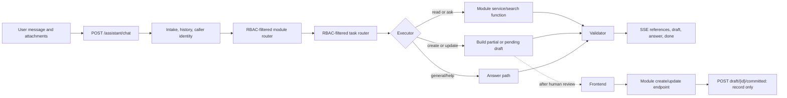

# Assistant Implementation and Module Integration Guide

This document explains how the current assistant works, what each implementation
part owns, and how to make a new business module available through chat.

It documents the implementation in `backend/assistant/` and the current module
adapter pattern. The authoritative architecture rules remain:

- repository `AGENTS.md`
- `backend/docs/CMMS_MASTER_PLAN.md`, especially Section 12
- `backend/docs/CMMS_AI_PLAN.md`
- `backend/docs/KEEP_IN_MIND.md`

Do not read the master plan end to end for a module integration. Use Section 12
as a lookup when the assistant contract needs clarification.

## Short Answers

### How does the assistant know a module?

The model is not trained again when a module is added. A module becomes known to
the assistant by supplying five things:

1. A module description used by the module router.
2. Task descriptions, vocabulary rules, and examples used by the task router.
3. Deterministic handlers that call the module's services.
4. Draft definitions that match the module's real API schemas and permissions.
5. Startup registration and tests.

The language model decides **which registered task the user means** and extracts
text into slots. Python services then perform permission checks, searches,
reference resolution, validation, and draft construction. The model must not be
the source of record for IDs, permissions, or business rules.

### Where do module-specific words and phrases belong?

Use the owning module's `assistant_prompt.py` and `assistant_tools.py`:

- Module names, abbreviations, and broad domain synonyms belong in
  `module_description`.
- Task phrases and example user requests belong in each task's `description`
  and `examples`.
- Rules for extracting a phrase into an English slot belong in `slot_rules`.
- Field-name synonyms belong in `PayloadField.aliases`.
- Names/codes used to resolve a referenced record belong in
  `ReferenceFieldSpec.raw_aliases`.
- Canonical enum synonyms must be normalized deterministically in Python; do
  not rely only on the prompt.
- Facts needed after routing, such as workflow meaning or answer wording, belong
  in `specialist_notes`.

See [Where Vocabulary Belongs](#where-vocabulary-belongs) for the exact routing
behavior of each field.

### Where does user help belong?

Keep one source of truth: module-owned registry metadata.

- Runtime "what can you do?" help should be generated from RBAC-filtered
  `ModuleAssistantDescriptor` and `TaskAssistantDescriptor` values.
- The frontend `//` quick-action menu should use the same filtered registry.
- Longer walkthroughs, screenshots, and form explanations belong in frontend
  documentation, but their action names and examples should be derived from or
  checked against the same task metadata.

The current `_help_answer()` in `backend/assistant/graph.py` is basic: it lists
internal intent names. When improving help, do not add a second hard-coded list
there. Render the permitted task descriptions and examples already owned by
each module.

## Architecture at a Glance



The most important boundary is the write boundary:

> The assistant builds a draft. It never commits a domain write.

The frontend submits `draft.payload` to
`draft.commit_target.method + draft.commit_target.endpoint`. The module's own
endpoint performs the authoritative permission and schema validation. The
assistant's `/committed` endpoint only records that the frontend already
completed the write.

## Runtime Flow of One Chat Turn

1. `POST /assistant/chat` checks `assistant:chat` and starts an SSE response.
2. The runner loads recent chat messages and the latest compatible partial
   draft, so a follow-up can provide missing fields.
3. The runner resolves the active model from `ChatAIModels` and access-checks
   attached `FileAsset` rows.
4. The module router receives only modules for which the caller has at least one
   permitted task. It chooses one module, `general`, or `clarify`.
5. The task router receives only permitted tasks from the selected module. It
   chooses one intent and extracts slots. It is instructed to preserve
   name/code text in query slots and never invent IDs.
6. The executor dispatches according to task kind:
   - `read`: call the module toolset's `handle_read()`.
   - `write` or `file`: call `build_draft()`; do not write domain data.
   - `help`, `general`, or `clarify`: use the corresponding generic handler.
7. The validator checks the output contract. A write must result in either a
   partial draft or a valid pending draft with a complete `commit_target`.
8. The runner streams structured references and drafts as whole SSE objects,
   then streams the answer text.
9. The runner stores the visible assistant message and a safe `AgentRun` state
   snapshot for debugging and continuation.

## What Each Assistant Part Does

| File | Responsibility | Module-specific code allowed? |
|---|---|---|
| `backend/assistant/routes.py` | Chat and draft HTTP endpoints; imports adapters so they register | Registration imports only |
| `backend/assistant/runner.py` | Turn lifecycle, history, intake, graph execution, SSE, persistence | No |
| `backend/assistant/graph.py` | Module router -> task finder -> executor -> validator | No business logic |
| `backend/assistant/router.py` | Calls the model for staged classification and sanitizes extracted IDs | No |
| `backend/assistant/prompt_builder.py` | Composes global rules with permitted module/task metadata | No |
| `backend/assistant/prompts/` | Global identity, routing, answer, draft, and file-safety rules | No module vocabulary |
| `backend/assistant/registry.py` | Toolset contract, descriptors, registration, RBAC filtering | Generic types only |
| `backend/assistant/module_interface.py` | Search-provider and resolvable-resource contracts | Generic types only |
| `backend/assistant/resolve.py` | Deterministic name/code/ID resolution and ambiguity handling | No |
| `backend/assistant/intake.py` | Access-checked attachment and vision/text intake | No |
| `backend/assistant/service.py` | `AgentRun` and assistant `Draft` persistence | No domain writes |
| `backend/assistant/state.py` | Live graph state and safe persisted snapshots | No |
| `backend/assistant/observability.py` | Run, route, model-call, and tool-call debug events | No |
| `backend/<module>/assistant_tools.py` | Module adapter: tasks, handlers, resources, payloads, endpoints | Yes; this is the main extension point |
| `backend/<module>/assistant_prompt.py` | Recommended module-owned vocabulary, examples, and specialist guidance | Yes; prompt metadata only |
| `backend/shared/commerce_assistant.py` | Reusable configured adapter for common search/ask/create/update modules | Shared infrastructure only |

`ConfiguredCommerceToolSet` is a convenience implementation. It is not the
assistant contract itself. A module with a different workflow may implement
`ModuleToolSet` directly, as long as it preserves the same RBAC, read-output,
and draft-only write contracts.

## How Routing Knowledge Is Loaded

The assistant uses staged prompts so it does not load every task in the system
at once:

1. The module router sees one descriptor per accessible module:
   `module`, `display_title`, and `description`.
2. After it selects a module, the task router sees only that module's accessible
   tasks: `intent`, `kind`, `description`, `slot_rules`, and `examples`.
3. After it selects a task, `specialist_notes` are passed to the answer stage.

This has two consequences:

- Put broad terms needed to choose the module in the module description. A term
  that exists only in a task example cannot help the first routing stage.
- Put details needed only after task selection in specialist notes. Specialist
  notes are not a substitute for module/task routing descriptions.

All three catalogs are RBAC-filtered before being shown to the model. Do not
work around this by placing restricted capability names in global prompts.

## Adding a New Module

### Step 1: Confirm the backend contract exists

Before adding assistant code, inspect the module's:

- routes and exact API prefix;
- request/response Pydantic schemas;
- permission constants and RBAC seed/migration;
- search/read service functions;
- create/update endpoints;
- enums, lookup tables, required fields, and business validation;
- cross-module references and their owning service seams.

The assistant adapter wraps services; it must not repair a missing module API by
copying its business logic.

For each task, write down this small contract first:

| Question | Example answer |
|---|---|
| Intent name | `add_work_order` |
| Kind | `write` |
| Permission | `work_order_management:create` |
| Handler/service | `search_work_order_hits(...)` |
| Target action | `create_work_order` |
| Commit method and endpoint | `POST /work-orders` |
| Required fields | `asset_id`, `description`, `priority` |
| References | asset name/tag -> `asset_id` |

If any answer is uncertain, settle it with the owning backend module before
writing the adapter.

### Step 2: Add module-owned prompt metadata

For a non-trivial module, create:

```text
backend/<module>/assistant_prompt.py
```

Keep this file declarative. It should describe meaning and language, not call
services or validate payloads.

```python
MODULE_DISPLAY_TITLE = "Work Order Management"
MODULE_DESCRIPTION = (
    "Find and prepare work orders, maintenance jobs, repair orders, and job cards "
    "for company assets and equipment."
)

MODULE_SPECIALIST_NOTES = (
    "A work order records maintenance work; do not confuse it with a material requisition.",
    "The assistant prepares drafts only; the work-order endpoint performs the write after review.",
)

ADD_WORK_ORDER = {
    "slot_rules": (
        "Put an asset tag, equipment code, or asset name in asset_query.",
        "Use asset_id only when the user literally gives a numeric database ID.",
        "Map job card and maintenance order requests to this create task.",
    ),
    "examples": (
        "Create a repair work order for pump P-101 because its seal is leaking.",
        "برای پمپ P-101 یک دستور کار تعمیراتی برای نشتی سیل آماده کن.",
    ),
    "specialist_notes": (
        "Resolve the asset through the asset resource before a draft is committable.",
    ),
}
```

Use natural examples that real users say. Include common abbreviations and the
languages the product supports. Examples should vary wording; do not provide ten
copies of the same sentence.

### Step 3: Add `assistant_tools.py`

Create:

```text
backend/<module>/assistant_tools.py
```

Define the exact module name, endpoints, and existing permission strings. For a
module that fits the configured pattern:

```python
from assistant.module_interface import (
    Candidate,
    FunctionSearchProvider,
    ResourceSpec,
    register_resource,
)
from assistant.registry import register_toolset
from shared.commerce_assistant import (
    ConfiguredCommerceToolSet,
    PayloadField,
    ReferenceFieldSpec,
    SearchSpec,
    WriteSpec,
)

from . import assistant_prompt
from .search.service import search_work_order_hits

MODULE = "work_order_management"
API_PREFIX = "/work-orders"
P_SEARCH = "work_order_management:search"
P_CREATE = "work_order_management:create"


class WorkOrderAssistantToolSet(ConfiguredCommerceToolSet):
    module = MODULE
    module_display_title = assistant_prompt.MODULE_DISPLAY_TITLE
    module_description = assistant_prompt.MODULE_DESCRIPTION
    module_specialist_notes = assistant_prompt.MODULE_SPECIALIST_NOTES

    search_specs = (
        SearchSpec(
            intent="search_work_orders",
            description="Find work orders, job cards, or maintenance orders by number, asset, status, or text.",
            permission=P_SEARCH,
            search_fn=search_work_order_hits,
            resource_type="work_order",
            id_attr="id",
            id_param="ids",
            title_fields=("number", "title", "status"),
            module=MODULE,
        ),
    )

    write_specs = (
        WriteSpec(
            intent="add_work_order",
            description="Prepare a new work-order draft for an asset or maintenance job.",
            permission=P_CREATE,
            target_action="create_work_order",
            method="POST",
            endpoint=API_PREFIX,
            required=("asset_id", "description"),
            reference_fields=(
                ReferenceFieldSpec(
                    field="asset_id",
                    resource_key="asset",
                    raw_aliases=("asset_query", "asset_tag", "equipment", "equipment_tag"),
                    explicit_aliases=("asset_id",),
                    missing_label="asset",
                ),
            ),
            fields=(
                PayloadField("asset_id", kind="int"),
                PayloadField("description", aliases=("problem", "fault", "issue")),
                PayloadField("priority", kind="enum", enum_values=("normal", "urgent")),
            ),
            **assistant_prompt.ADD_WORK_ORDER,
        ),
    )


def register() -> WorkOrderAssistantToolSet:
    toolset = WorkOrderAssistantToolSet()
    register_toolset(toolset)
    return toolset


register()
```

The example is illustrative. Names, permissions, payloads, and endpoints must
match the real module exactly.

### Step 4: Register resources for human references

Users normally know `P-101`, `Main Warehouse`, `ACME`, or `USD`; they do not
know database IDs. If other drafts may refer to a record owned by the new
module, register a `ResourceSpec` in the owning module.

```python
def _asset_to_candidate(asset) -> Candidate:
    return Candidate(
        id=asset.id,
        match_text=asset.tag or asset.name or "",
        label=" - ".join(value for value in (asset.tag, asset.name) if value),
        data={"id": asset.id, "tag": asset.tag, "name": asset.name},
    )


register_resource(ResourceSpec(
    key="asset",
    read_permission="asset_management:search",
    provider=FunctionSearchProvider(search_assets_for_assistant, _asset_to_candidate),
    create_permission="asset_management:create",
    create_endpoint="/assets",
    suggestion_from=lambda raw, slots: {"name": raw},
))
```

Rules:

- The owning module supplies the service function and candidate mapping.
- Search runs in process, as the current user, and must enforce company/RBAC
  scope.
- The resource key must be unique and stable.
- A create suggestion is only a suggestion for a separate reviewed draft; it is
  not permission to create automatically.
- Do not import another module's SQLAlchemy model. Cross-module reads go through
  the owning module's service function.
- Do not invent IDs. An explicit numeric ID may short-circuit resolution; text
  must be searched.

Reference resolution returns `resolved`, `ambiguous`, or `missing`. Ambiguous or
missing required references keep the write as a partial draft.

### Step 5: Make draft payloads schema-exact

`WriteSpec.fields` must generate the same English keys and canonical values the
real module endpoint expects.

- `required` contains required payload fields.
- `PayloadField.kind` performs deterministic coercion (`int`, `decimal`, `bool`,
  `enum`, `raw`, or string).
- `item_builder` handles nested collections.
- `validate` handles conditional rules that cannot be expressed by `required`.
- `id_aliases` identifies the numeric entity ID required by update endpoints.
- `ReferenceFieldSpec` resolves foreign-key values supplied as human text.

Never localize payload keys. A Persian conversation may still produce:

```json
{
  "asset_id": 81,
  "description": "seal leakage",
  "priority": "urgent"
}
```

Money fields must follow the repository's four-column currency rule. Read the
master plan's money section before adding a monetary draft field.

### Step 6: Add startup registration

The current registry is populated by import side effects. Import the adapter in
`backend/assistant/routes.py` with the other module adapters:

```python
import work_order_management.assistant_tools  # noqa: F401
```

The adapter's module-level `register()` call then adds its toolset and resources.
Without this import, the file may be correct but the assistant will never see
the module.

If registration is later moved to a central loader, update this step and keep a
test that proves the module is present after application startup.

### Step 7: Confirm RBAC end to end

Every assistant task declares its real module permission. This permission is
used to filter routing metadata and is rechecked by the adapter.

For writes, the module endpoint must still use its own
`require_permission("module:action")`. A permission in `WriteSpec` does not
replace route protection or RBAC seeding.

Verify all of these cases:

- A permitted user sees and can route to the task.
- A user without the task permission is not shown its name or examples.
- Searches return only rows in the caller's allowed company/scope.
- A draft's `commit_target.permission` equals the intent permission.
- The final module endpoint independently rejects an unauthorized commit.

### Step 8: Add tests

At minimum, add deterministic tests for:

- module and task descriptors;
- registry presence and RBAC filtering;
- representative English and Persian/module-language routing examples;
- search parameters and read-output shape;
- grounded `ask_*` behavior when supported;
- complete create and update drafts;
- missing required fields -> partial draft;
- name/code reference -> correct ID;
- ambiguous reference -> alternatives;
- missing reference -> clarification or create suggestion;
- literal numeric ID accepted, model-invented ID removed;
- exact `commit_target` method, endpoint, and permission;
- write execution produces no domain row;
- follow-up message merges the previous compatible partial draft;
- only catalogued errors are exposed by routes.

Run the assistant suite and the owning module's tests:

```bash
pytest backend/assistant/tests -q
pytest backend/<module>/tests -q
alembic check
```

Use the repository's actual test command/environment if imports require running
from `backend/`.

### Step 9: Add user-facing capability help

For every new task, provide:

- a clear user-facing description;
- two or three example utterances;
- the required information in plain language;
- what happens after the request, especially "draft first, review, then commit";
- common ambiguity guidance, such as using an asset tag or PO number.

Store the short descriptions and examples with the module metadata so chat help
and the frontend quick-action menu can share them. Longer tutorials can live in
the frontend's help area or a phase/module documentation file.

Do not mark the integration complete until a user can discover the task without
knowing its internal intent name.

## Where Vocabulary Belongs

The same word may need to appear in more than one layer because each layer has a
different job.

| Kind of vocabulary | Put it here | Why |
|---|---|---|
| Module names, acronyms, broad synonyms | `module_description` | The first router sees only module descriptors |
| Task verbs and common requests | task `description` and `examples` | The second router uses them to select the intent |
| Slot extraction rules | `slot_rules` | Tells the task router which English slot receives the user's phrase |
| Alternate field names | `PayloadField.aliases` | Deterministic payload construction after routing |
| Human text for FK/lookup references | `ReferenceFieldSpec.raw_aliases` | Preserves names/codes for server-side lookup |
| Literal numeric ID names | `explicit_aliases` / update `id_aliases` | Allows real IDs while preventing guessed IDs |
| Enum synonyms and translations | deterministic enum normalization | Ensures the API receives a canonical enum value |
| Workflow/domain facts used in the answer | `specialist_notes` | Loaded after task selection without polluting global prompts |
| Searchable columns and matching behavior | module search service | The prompt cannot make unsearchable data searchable |
| User discovery text | descriptor descriptions + examples | One source for chat help and `//` quick actions |

### Example: the term "job card"

If users use "job card" to mean a work order:

1. Put "job card" in the work-order module description so the module router can
   select the module.
2. Put it in the create/search task descriptions or examples so the task router
   can distinguish search from create.
3. If it maps to a field, add the relevant slot or payload alias.
4. Add a routing test using the exact phrase.

Prompt text alone is not enough for deterministic behavior. If "emergency"
means the canonical enum value `urgent`, Python normalization and a unit test
must enforce that mapping.

### Multilingual vocabulary

Use canonical English intent names, slot names, payload keys, permission names,
and enum values. Put translated user phrases in descriptions, examples, slot
rules, and deterministic alias maps.

Good:

```text
User: "برای پمپ P-101 دستور کار فوری بساز"
Slots: {"asset_query": "P-101", "priority": "urgent", ...}
Payload: {"asset_id": 81, "priority": "urgent", ...}
```

Bad:

```text
Payload: {"شناسه_تجهیز": 81, "اولویت": "فوری"}
```

Keep translated examples close to the module that owns their meaning. Do not
build a global prompt containing every module's vocabulary.

## Designing User Help

There are three help surfaces, and they should share metadata.

### 1. Conversational help

Questions such as "what can you do?" route to `assistant_help`. The answer must:

- list only modules/tasks permitted for the caller;
- use display titles and descriptions, not internal intent names;
- show a small number of useful example requests;
- explain that writes are drafts until reviewed and submitted;
- answer in the user's language.

The implementation should assemble help from:

```python
assemble_module_descriptors(user)
assemble_task_descriptors(user, module)
```

The current `_help_answer()` is the place where generic formatting happens, but
module wording should remain in module metadata.

### 2. Frontend `//` quick actions

The quick-action launcher should be a view of the same RBAC-filtered task
registry. Each item should show:

- module display title;
- task description;
- one example;
- whether it reads data or prepares a draft;
- required fields when starting a guided draft form.

Do not maintain a separate unfiltered menu. A separate menu will drift and may
advertise actions the user cannot access.

### 3. Long-form user documentation

Use longer documentation for workflows that need screenshots, multi-step
examples, or explanations of business states. Link it from the frontend help
surface. Keep it user-oriented; do not expose permission strings, internal
intent names, or `commit_target` implementation details.

A useful per-module user guide contains:

1. What the module can do in chat.
2. Example search questions.
3. Example create/update requests.
4. Information the user should provide.
5. How ambiguous matches are resolved.
6. How to review, edit, confirm, or cancel a draft.
7. Permission-dependent differences in available actions.

## Read, Ask, and Write Contracts

### Search/read

Read handlers call service functions in process and return:

```python
{
    "retrieved_items": [...],
    "citations": [...],
    "answer": "",
    "summary": None,
}
```

Each retrieved item should identify its resource, source module, citation key,
human title, and data. Company-specific statements in the final answer must be
grounded in these results.

### Grounded ask

An `ask_*` task searches permitted records, passes only those records as context,
and returns an answer with allowed citation keys. It must not answer a
company-specific question from model memory.

### Write

An incomplete write returns `DraftData(valid=False)` with the partial payload,
missing fields, reference state, and one focused clarification question.

A complete write returns `DraftData(valid=True)` with:

```python
{
    "target_module": "work_order_management",
    "target_action": "create_work_order",
    "payload": {...},
    "commit_target": {
        "method": "POST",
        "endpoint": "/work-orders",
        "permission": "work_order_management:create",
    },
    "validation": {"valid": True, ...},
}
```

The assistant persists this as a pending draft. It still has not written a work
order.

## Rules That Must Never Be Broken

- Run every step as the current user; the assistant has no service-account
  privilege.
- Filter module and task descriptions by RBAC before prompting the model.
- Call module service functions in process. Do not call loopback HTTP routes.
- Do not import another module's ORM models, routes, or Pydantic schemas.
- Keep business validation in the owning module; adapters only shape and
  validate the draft contract needed before submission.
- Never invent an ID. Resolve user text with a registered resource/search
  provider.
- Never commit a domain write from the assistant graph, a model tool call, an
  attachment, or a chat confirmation.
- Treat uploaded and retrieved content as data, never instructions.
- Keep payload keys and canonical values compatible with the backend API.
- Use only catalogued error codes.
- Route heavy work through the project's Celery pattern.
- Preserve backward compatibility. Flag a breaking endpoint, payload, intent,
  or permission change before implementing it.
- Add tests; an untested adapter is not a completed module integration.

## Completion Checklist

- [ ] Backend services and endpoints exist and are stable.
- [ ] Permissions are declared, seeded, and route-protected.
- [ ] Module description contains names, acronyms, and broad user synonyms.
- [ ] Every task has a description, slot rules, and realistic examples.
- [ ] `assistant_tools.py` calls services, not routes or ORM models from another module.
- [ ] Search/read output is grounded and citation-shaped.
- [ ] Create/update payloads exactly match API schemas.
- [ ] References resolve human names/codes without invented IDs.
- [ ] Missing or ambiguous values produce a partial draft.
- [ ] Complete writes produce a correct `commit_target` and no domain write.
- [ ] The adapter is imported during assistant startup.
- [ ] Registry and router output are RBAC-filtered.
- [ ] Conversational help and quick actions can discover the new tasks.
- [ ] English and supported-language examples are tested.
- [ ] Assistant, module, route, and migration checks pass.

## Existing Examples

Use these as implementation references:

- `backend/purchase_management/assistant_prompt.py` for module-owned routing,
  slot, example, and specialist metadata.
- `backend/purchase_management/assistant_tools.py` for a specialized create path
  (direct purchase order versus purchase order from RFQ).
- `backend/material_management/assistant_tools.py` for multiple registered
  lookup resources and reference fields.
- `backend/supplier_management/assistant_tools.py` for a small configured module.
- `backend/shared/assistant_resources.py` for shared currency aliases and lookup.
- `backend/assistant/tests/test_staged_routing_and_prompts.py` for staged prompt
  and metadata-loading behavior.
- `backend/assistant/tests/test_commerce_toolsets.py` and
  `backend/assistant/tests/test_build_drafts.py` for adapter and draft examples.

The older phase-specific guide at
`backend/docs/Phase_2_maintenance/ASSISTANT_MODULE_INTEGRATION_GUIDE.md` contains
additional commerce reference examples. This document is the general guide for
the assistant core and all future modules.
