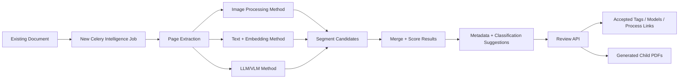

# Independent Document Intelligence Project Plan

## Summary
Build a separate **Document Intelligence** module that runs as a new Celery workflow and can be used by the existing Porsa backend without changing the old document ingestion/search behavior.

The module will analyze already-uploaded PDFs, detect whether one PDF contains multiple logical documents or sections, classify each page range, extract metadata, suggest tags/models/process links, and optionally generate new child PDF documents from the detected page ranges.

Default decisions:
- Input: PDF only.
- Processing unit: page ranges.
- Output split files: child documents linked to the original parent document.
- Unknown models: create suggestions first; users approve before real `ManagedModel` creation.
- Old pipeline: untouched except for optional integration points.

## Architecture

 
## Main Capabilities
- Detect document boundaries inside a mixed PDF.
- Classify each page range by:
  - tag,
  - managed model/instrument,
  - process/part/category,
  - unknown model candidate.
- Extract useful metadata:
  - title,
  - summary,
  - detected language,
  - page range,
  - key terms,
  - model/manufacturer candidates,
  - confidence score,
  - evidence text.
- Generate child PDFs from accepted page ranges.
- Link child documents and/or parent page ranges to existing tags and models.
- Suggest new models when the detected model does not exist.

## New Celery Workflow
Create a new task, separate from the old MinerU ingestion task:

```text
document_intelligence.process_document
```

Workflow steps:
1. Load an existing processed PDF/document.
2. Render pages to images for visual methods.
3. Extract or reuse text per page from MinerU/chunks.
4. Run three segmentation/classification approaches.
5. Normalize all results into one shared segment format.
6. Merge overlapping predictions.
7. Store suggestions and confidence scores.
8. Wait for user review.
9. On approval, generate child PDFs and create links to tags/models.

The old Celery task for PDF ingestion remains unchanged.

## Three Research Methods
### 1. Image Processing Method
Use page images to detect boundaries and document changes.

Planned techniques:
- Page visual similarity.
- Layout changes.
- Header/footer changes.
- Logo/table/image pattern changes.
- Image hash or feature-vector comparison.
- Optional visual embedding model for page similarity.

Goal:
- Detect where one logical document ends and another begins without relying on text.

### 2. Text + Embedding Method
Use extracted page/chunk text and lightweight embedding models.

Planned techniques:
- Embed each page or chunk.
- Compare adjacent pages for semantic shift.
- Compare page ranges against tag/model descriptions.
- Detect model names/manufacturers from text.
- Cluster similar pages into logical sections.

Goal:
- Low-cost classification and segmentation suitable for production.

### 3. LLM/VLM Method
Use LLMs and VLMs as the highest-quality comparison baseline.

Planned techniques:
- LLM over extracted text for segmentation/classification.
- VLM over page images when layout or scanned documents matter.
- Structured JSON output with page ranges, labels, evidence, and confidence.

Goal:
- Compare quality against cheaper methods and decide where LLM/VLM usage is worth the cost.

## Data Model Additions
Add independent tables for this project, without changing old tables unless absolutely necessary.

Core tables:
- `document_intelligence_jobs`
  - document id, status, method config, error, timestamps.
- `document_segments`
  - parent document id, start page, end page, title, summary, confidence.
- `document_segment_suggestions`
  - segment id, suggestion type, target type, target id, proposed name, confidence, evidence, status.
- `document_split_outputs`
  - parent document id, segment id, child document id, generated PDF asset id.
- `model_creation_suggestions`
  - manufacturer, model, type, description, evidence, confidence, status.

Suggestion status:
```text
pending | accepted | rejected
```

Job status:
```text
queued | running | completed | failed | cancelled
```

## API Plan
Add new routes under a separate namespace:

```text
POST   /document-intelligence/jobs
GET    /document-intelligence/jobs/{job_id}
GET    /document-intelligence/documents/{doc_id}/segments
GET    /document-intelligence/segments/{segment_id}/suggestions
PATCH  /document-intelligence/suggestions/{suggestion_id}
POST   /document-intelligence/segments/{segment_id}/split
POST   /document-intelligence/model-suggestions/{suggestion_id}/accept
```

Acceptance behavior:
- Accept tag suggestion: create or update tag-document/page-range link.
- Accept model suggestion: link the segment/child document to existing `ManagedModel`.
- Accept unknown model suggestion: create `ManagedModel`, then link it.
- Split segment: create a child PDF and child document record linked back to the parent.

## Academic Project Structure
Research questions:
- Which method best detects boundaries inside mixed technical PDFs?
- Which method best classifies page ranges into tags/models/process parts?
- What is the tradeoff between accuracy, latency, and cost?
- Can lightweight embedding models perform well enough compared with LLM/VLM methods?

Evaluation dataset:
- Build a labeled set of mixed PDFs.
- For each PDF, manually label true page ranges, tags, models, and process parts.
- Include simple PDFs, scanned PDFs, multi-instrument PDFs, and documents with unknown models.

Metrics:
- Boundary detection precision/recall/F1.
- Classification accuracy.
- Unknown-model detection accuracy.
- Metadata quality score.
- Processing time per page.
- Cost per document.
- Human correction rate.

## Implementation Phases
1. **Foundation**
   - Add new module, tables, schemas, routes, and Celery task.
   - Store jobs, segments, suggestions, and review statuses.

2. **PDF Page Pipeline**
   - Load parent document.
   - Extract page text.
   - Render page images.
   - Store per-page analysis artifacts.

3. **Method 1: Image Processing**
   - Implement visual boundary detection.
   - Produce segment candidates.

4. **Method 2: Text + Embeddings**
   - Implement page embeddings, semantic shift detection, and tag/model matching.
   - Produce segment and metadata suggestions.

5. **Method 3: LLM/VLM**
   - Implement structured prompt output.
   - Validate JSON output and store suggestions.

6. **Result Merging**
   - Combine method outputs.
   - Score confidence.
   - Prefer human review before applying changes.

7. **Review + Split**
   - Accept/reject suggestions.
   - Generate child PDFs from accepted page ranges.
   - Link child documents to parent, tags, models, and created model records.

8. **Evaluation + Report**
   - Run all three methods on the same dataset.
   - Compare metrics.
   - Write final academic report and implementation documentation.

## Test Plan
- Job creation does not modify old document processing.
- Job fails cleanly if the source document is missing or not processed.
- Page-range segments are valid and non-overlapping after merge.
- Image method returns boundary candidates.
- Embedding method classifies against existing tags/models.
- LLM/VLM method returns valid structured output or a controlled failure.
- Unknown model suggestion does not create a model until accepted.
- Accepted model suggestion creates or links `ManagedModel`.
- Accepted tag suggestion creates the expected tag-document link.
- Split segment creates a child PDF and child document.
- Child document remains linked to the original parent document.
- All APIs enforce company/user access rules.

## Assumptions
- This is a separate project/module inside the same backend, not a rewrite of the old system.
- Old upload, MinerU ingestion, chunking, and search endpoints remain compatible.
- The new system operates after a document already exists.
- Human review is required before creating new models or applying classification links.
- Child documents are the preferred output for separated PDF parts.


