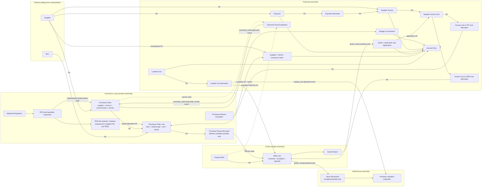
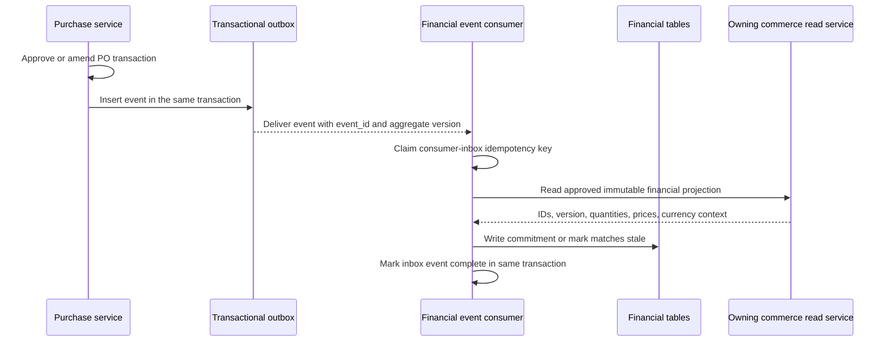
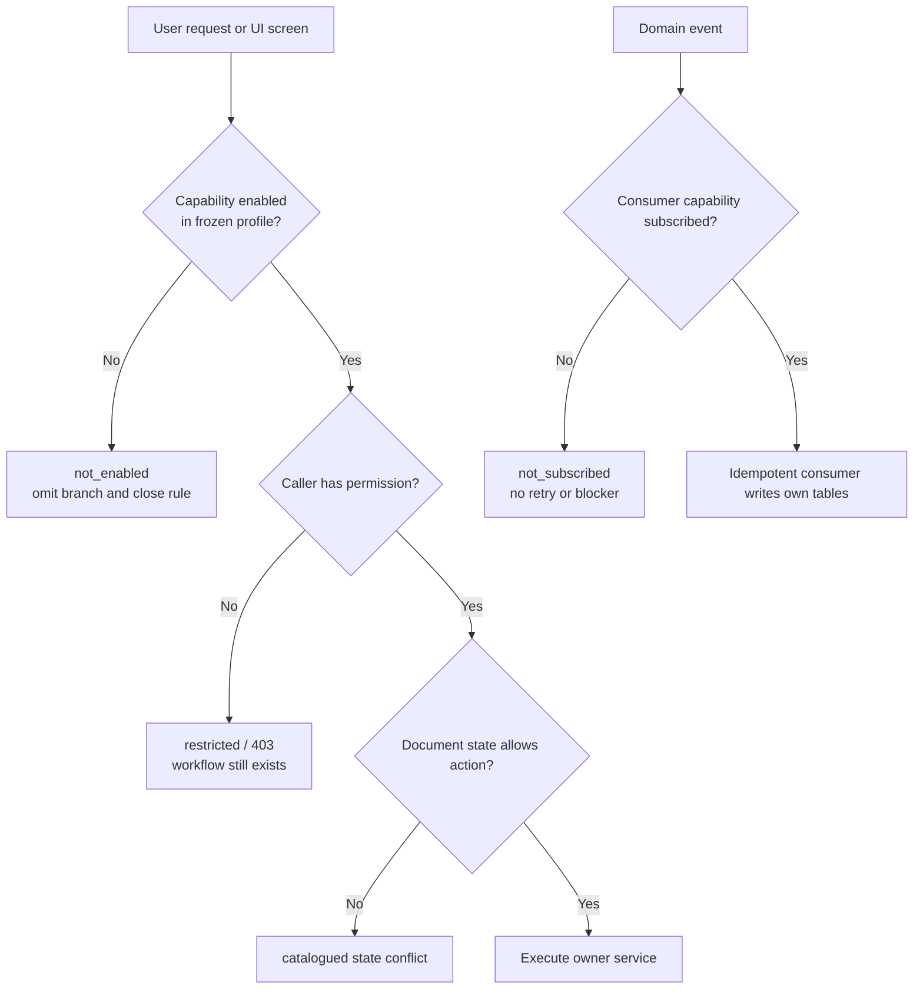

# Phase 1.3 — Commerce and Financial Integration

Status: implementation specification; no backend code is included in this document.

This specification was reconciled with repository commit `81ce63f` (`normalize purchase order supplier ownership`) on 2026-07-19. The actual SQLAlchemy models, services, routes, migrations, permissions, error constants, and tests take precedence over older prose where they disagree.

## 1. Purpose and scope

Phase 1.3 connects requisition, RFQ, purchase order, delivery, goods receipt, warehouse valuation, accounts payable, payment, claims, and accounting without making any document a duplicate of another document.

The governing rule is: one business fact has one owner. A foreign key is a relationship, not a duplicated fact. Similar values on different documents remain different facts: requested, quoted, ordered, physically received, billed, and paid quantities or amounts are not interchangeable.

Most of the Phase 1.2 normalized PO baseline now exists: `PurchaseOrderLine`, `PurchasePhaseAllocation`, automatic Phase 1 creation, atomic/idempotent delivery splitting, direct-MR creation, normalized GRN allocation references, removal of `PurchasePhaseItem`, source cleanup, and mandatory normalized `supplier_id`. Phase 1.3 must integrate with that live baseline and must not recreate the removed legacy phase-item design.

This specification distinguishes three states so implementation can proceed safely:

1. **Implemented Phase 1.2 baseline** — the structures and contracts currently in the repository.
2. **Phase 1.2 completion gate** — cleanup still required before financial posting is enabled, especially durable events, commercial amendments/cancellation controls, common PO currency ownership, and source-award cardinality.
3. **Phase 1.3 financial target** — AP, matching, payment, claims, landed cost, accounting, and financial close.

Phase 1.3 is procure-to-pay and Accounts Payable scope. It does not implement the selling department, sales orders, customer delivery, customer invoices, or Accounts Receivable. A finance user is an internal RBAC `User`, not a customer or supplier. `FinancialCustomer` is a legacy contact/counterparty object and must not be used as the supplier master. A future order-to-cash phase should introduce customer/sales ownership, ideally over a shared `Party` identity with supplier/customer roles.

Phase 1.3 is capability-based, not all-or-nothing. Procurement remains usable when optional features such as RFQ line awards, receiving, warehouse stock, AP, payments, commitments, claims, landed cost, general ledger, or financial close are disabled for a company. Company capability activation and user RBAC are separate decisions: a disabled capability is not part of the company's workflow, while an enabled capability may still be hidden from a particular user. Lack of user permission never waives a company obligation or close blocker.

The shared `material_management.Item` is the catalog object used by requisition, RFQ, PO, GRN, warehouse, finance, and future maintenance. Names and codes are resolved from the material service for display; they are not copied as current-state columns.

The target sequence is:

```text
MR -> RFQ/quotation -> PO/PO lines -> phase allocations
   -> delivery exception OR posted GRN/accepted quantity
   -> supplier invoice -> three-way match -> AP approval
   -> payment allocation / credit / claim
   -> landed-cost allocation -> warehouse valuation
   -> accounting entries -> financial close
```

Accounting policy is company-configurable. This document uses IFRS concepts only as a safe baseline, not as a substitute for the company's jurisdiction-specific accounting advice. The [IFRS Foundation's IAS 2 summary](https://www.ifrs.org/issued-standards/list-of-standards/ias-2-inventories/) says inventory cost includes purchase, conversion, and other costs incurred to bring inventory to its present location and condition, and that inventory losses are expensed when incurred. [IAS 21](https://www.ifrs.org/issued-standards/list-of-standards/ias-21-the-effects-of-changes-in-foreign-exchange-rates/) governs which exchange rates are used and how exchange effects are reported. [IFRIC 22](https://www.ifrs.org/issued-standards/list-of-standards/ifric-22-foreign-currency-transactions-and-advance-consideration/) addresses foreign-currency advance consideration. [IAS 37](https://www.ifrs.org/issued-standards/list-of-standards/ias-37-provisions-contingent-liabilities-and-contingent-assets/) requires cautious treatment of uncertain recoveries; a claim is not automatically a recognised receivable merely because it was filed.

## 2. Current implementation audit

### 2.1 Already implemented

| Area | Actual implementation |
|---|---|
| Currency | `Currency` and `ExchangeRate` exist. Rates are `Numeric(28,10)` and services select the closest rate on or before a date. Company has a base-currency relationship. |
| Supplier | Supplier, contacts, categories, documents, and evaluations exist. `purchase_orders.supplier_id` now has a real FK to `suppliers.id`. |
| Material | `Item` and `Unit` exist and are the correct catalog references. |
| Requisition | MR header, MR items, status history, approval transitions, and optional estimated money fields exist. |
| RFQ | RFQ, multiple invited suppliers, items, quotation responses/items, whole-response winner selection, and complete/common-currency winner validation exist. Line-level awards do not exist. |
| Purchase | Normalized PO header, PO lines, scheduling-only phases, phase allocations, automatic Phase 1, idempotent split delivery, manual/RFQ/direct-MR creation, approval, and supplier FK normalization exist. `PurchasePhaseItem` and its public routes are removed. Legacy extra-cost records and generic receipt links remain. |
| Goods receipt | Draft/post flow, allocation-linked lines, received/accepted/rejected quantities, mandatory rejection reason, warehouse/location validation, and multiple GRNs per PO exist. GRN lines still retain catalog and provisional-price snapshots. |
| Warehouse | Stock balances, immutable movement records, idempotent GRN receipt movement creation, and weighted-average balance updates exist. Only accepted GRN quantity is emitted to warehouse. |
| RBAC | Commerce modules declare permissions and `seed_rbac.py` imports them. Routes inspected are protected. |
| Errors | Commerce constants exist, and the global exception handlers standardize response shape. |

### 2.2 Financial models that actually exist

`financial_management` currently owns only:

- `FinancialCard`: a bank/card account-like record;
- `FinancialCustomer`: a generic counterparty/contact record;
- `FinancialReceipt`: a generic inbound/outbound cash receipt with free-text currencies;
- receipt files and receipt-comment links.

It does **not** contain supplier invoices, invoice lines, AP liabilities, three-way matches, payments as a controlled posting object, payment allocations, advances, debit notes, credit notes, claims, landed-cost allocations, budget commitments, chart of accounts, journal entries, or financial close.

`FinancialReceipt` is legacy/general cash evidence. Its `currency`, `base_currency`, `exchange_rate_to_base`, and `base_amount` fields predate the canonical currency FK pattern. Phase 0 explicitly preserved this legacy shape. It must not become the AP/payment ledger.

### 2.3 Current purchase and receipt problems

- The current code has seeded RBAC and `Company.allow_self_approval`, but no company capability registry or versioned workflow profile. It cannot yet distinguish “module disabled for this company” from “enabled but this user lacks permission.”
- Phase 1.2 physically stores the common product `currency_id` and `exchange_rate_used` on every PO line. Creation/submission validates equality, so the business has one context, but storage does not yet match the non-negotiable rule that `PurchaseOrder` owns that context.
- `UNIQUE (company_id, source_rfq_id)` and whole-response winner selection allow only one PO and one supplier winner per RFQ. This does not support line awards or two POs from one RFQ.
- The current RFQ creation service catches the removed constraint name `uq_purchase_orders_company_rfq`, while the live model/migration uses `uq_purchase_orders_company_source_rfq`; a race can therefore leak an uncatalogued `IntegrityError`. Align the handler with the live constraint while the uniqueness rule remains.
- `UNIQUE (company_id, source_material_requisition_id)` similarly permits only one direct-MR PO. It is correct only while direct purchase consumes the entire eligible MR selection in one operation.
- PO approval has no immutable `commercial_version`, amendment records, line-cancellation records, or approval event. Header updates are limited, while cancellation currently changes status without receipt/invoice/payment checks.
- RFQ/direct-MR PO creation synchronously calls requisition code to mark the MR ordered. GRN posting synchronously imports `purchase_management.services.apply_goods_receipt`; that purchase service then imports GRN SQLAlchemy models and changes PO/phase status. This violates both the model-import and event-write seams and must move to durable events plus owner-service reads.
- `add_phase()` remains as dead/stale service code and passes removed phase currency fields; the public create route is gone, but the stale function must be removed or made unreachable by tests.
- GRN lines correctly reference `purchase_phase_allocation_id`, but still copy `item_id`, names/codes, unit, PO price, currencies, base currency, and rate. Phase 1.3 matching must treat the allocation and owning services as authoritative; these current columns are compatibility/warehouse-posting snapshots, not invoice-price ownership.
- Current receipt status counts **accepted** quantity toward fulfilment, which is correct. Gross received and rejected projections must be derived separately for AP/dispute screens.
- `PurchaseOrderCost` only inserts a cost header. Nothing creates allocation rows, adjusts accepted receipt valuation, or posts accounting. `allocation_method` is inert metadata.
- `PurchaseOrderReceiptLink` stores a plain integer with no FK, does not validate the receipt in its service, permits duplicates, and has no allocated amount. This contradicts the current FK-default architecture and cannot model AP.
- GRN posting commits and then dispatches Celery; dispatch failures are logged and swallowed. This can lose stock and finance effects permanently.
- Current database objects are in the public schema despite the canonical schema-per-module contract. No model declares `schema=`, and migrations create unqualified tables.
- The PO ORM declares a cross-module `Supplier` relationship and reads it for display. The canonical seam requires supplier display resolution through `supplier_management` services; the FK remains real.
- Many services still raise ad-hoc `HTTPException` messages. `error_codes.py` is a constant list, not yet the complete registry/auto-export described by the master plan.

### 2.4 Test audit

Existing tests now cover normalized manual/RFQ/direct-MR creation, removal of legacy phase items/routes, GRN allocation builders and validations, supplier normalization, split success/idempotency, selected approval rules, financial receipt CRUD/search, and warehouse/reporting projections. Coverage is still incomplete for real database concurrency/trigger behavior, durable commerce events, amendments/cancellations, AP invoice lifecycle, three-way matching, partial payments, credits, claims, cost allocation, event-outbox recovery, finance permissions, populated-data migration, or financial close.

### 2.5 Classification by phase

| Classification | Scope |
|---|---|
| Already implemented | Currency master/rates; supplier/item/MR/RFQ foundations; normalized PO lines/phase allocations; automatic Phase 1; split delivery; manual/RFQ/direct-MR creation; GRN allocation link and accepted/rejected flow; legacy cost/receipt-link tables; stock movements/weighted balance; generic financial receipts. |
| Partially implemented | Phase 1.2 approval/source/cardinality, PO currency ownership, amendments/cancellation, cross-module event boundaries, GRN snapshot cleanup, inventory costing, catalogued errors, and migration/test completeness. |
| Remaining at the Phase 1.2 completion gate | Durable PO/MR/GRN status events; commercial version/amendment/cancellation controls; PO-level currency/rate ownership migration; removal of dead legacy services; and, if multiple POs per RFQ are required, line-award/release modeling plus removal of the one-PO-per-RFQ uniqueness rule. |
| Required for Phase 1.3 | AP, matching, payments/advances/allocations, notes, claims, delivery exceptions, landed-cost allocation, valuation integration, commitments, journals, financial status/close, reliable events, permissions/errors/tests, and compatibility migration. |

## 3. Domain ownership table

| Object | Owner | Reason |
|---|---|---|
| Company capability/workflow profile | `core`/platform configuration | Determines which workflows apply to a company/document; it is independent from individual user permissions. |
| Internal finance/buyer/receiver user | `core` identity and RBAC | A `User` is an actor with permissions, never the supplier/customer counterparty fact. |
| Supplier | `supplier_management` | Shared procure-to-pay counterparty referenced by RFQ, PO, supplier invoice, payment, note, and claim. |
| Item | `material_management` | Shared catalog identity used by commerce, warehouse, finance policy lookup, and future maintenance. |
| RFQ award/line award | `rfq_management` | Supplier/quotation selection and awarded quantity are sourcing decisions. |
| PO-line award allocation/release | `purchase_management` | Quantity of an approved RFQ line award committed into a concrete PO line. |
| Purchase order | `purchase_management` | Supplier, source, approval, and commercial status are procurement facts. |
| Purchase order line | `purchase_management` | Ordered item, quantity, purchasing unit, price, and PO description are commercial line facts. |
| Delivery phase/allocation | `purchase_management` | Scheduling and allocation only. |
| Delivery exception | `purchase_management` | It records failure before a warehouse receipt and drives supplier/carrier resolution. |
| Goods receipt/line | `goods_receipt_management` | Physical arrival, inspection, accepted/rejected quantity, and rejection reason. |
| Supplier invoice/line | `financial_management` | Supplier billing and AP liability. |
| Invoice-to-PO and invoice-to-GRN allocations | `financial_management` | They are financial matching decisions. |
| Payment | `financial_management` | Cash/bank settlement transaction. |
| Payment allocation | `financial_management` | Portion of a payment settling an invoice; invoice totals remain derived. |
| Supplier debit note | `financial_management` | Company claim/amount asserted against supplier. |
| Supplier credit note | `financial_management` | Supplier-issued reduction of liability/cost. |
| Supplier/carrier/insurance claim | `financial_management` | Recoverability, settlement, and accounting are financial decisions. |
| Goods return | `goods_receipt_management` | Reversal of previously accepted physical custody; warehouse acts by event. |
| Landed cost and allocation | `financial_management` | Capitalization/expense policy and monetary allocation require finance approval. |
| Stock movement/balance | `warehouse_management` | Physical stock ledger and operational balance. |
| Inventory accounting value | `financial_management` owns accounting entries; `warehouse_management` exposes the operational valuation projection | No module writes the other's ledger. |
| Accounting entry/line/account | `financial_management` | General-ledger facts. |
| Budget commitment | `financial_management` | Encumbrance/commitment is a financial-control fact created from approved PO events. |

Financial writes must not be placed under `/purchase`. Purchase screens may read finance projections through financial services.

## 4. Normalized target data model

### 4.1 Physical schema rule

Target schemas are `purchase_management`, `goods_receipt_management`, `financial_management`, `warehouse_management`, `material_management`, `supplier_management`, `requisition_management`, `rfq_management`, and shared `platform`. Current public-schema placement is a known violation. Schema relocation must be a coordinated pre-Phase-1.3 migration stream, one owner-scoped revision per module. Compatibility views may temporarily preserve public read names; no new authoritative table may be added to `public`.

All references below are real FKs in the shared database. Python code must not import another module's model, route, or Pydantic schema. Cross-module reads call services; cross-module writes consume events.

Every monetary bundle uses `Numeric(28,10)` and the four canonical elements: transaction amount, `currency_id`, base amount, and frozen `exchange_rate_used`. When one immutable header context applies to every child line, the header owns currency/rate and the child owns amount/base amount; the service exposes the four elements together. This satisfies the money contract without copying the same currency/rate fact to every line. Base currency is obtained from company configuration, not copied as `base_currency_id` on every row.

#### 4.1.1 Company capability and frozen workflow profile

The current code has RBAC but no company-level module/capability registry. Add a platform-owned capability registry and versioned workflow profile instead of scattering `is_enabled` booleans across PO, invoice, GRN, and payment tables:

```text
CompanyCapability
  id, company_id FK, capability_code
  enabled, effective_from, disabled_at NULL
  configured_by_user_id, reason, timestamps
  UNIQUE (company_id, capability_code)

CommerceFinanceWorkflowProfile
  id, company_id FK, version, status draft|active|retired
  invoice_match_mode none|two_way|three_way
  inventory_mode disabled|quantity_only|valued
  commitment_mode disabled|memo|ledger
  accounting_mode disabled|subledger_only|general_ledger
  effective_from, activated_by_user_id, created_at
  UNIQUE (company_id, version)

WorkflowProfileCapability
  workflow_profile_id FK, capability_code, enabled
  PRIMARY KEY (workflow_profile_id, capability_code)
```

`WorkflowProfileCapability` is the immutable snapshot for that profile version; `CompanyCapability` is the current administration projection. Purchase orders, supplier invoices, payments, claims, and landed costs each store one `workflow_profile_id` real FK because each can be separately approved or standalone. A downstream document defaults to the active compatible profile; references to upstream documents must pass profile compatibility validation. Do not copy every capability boolean onto every business document.

A multi-PO invoice may reference POs with different historical profile IDs only when their relevant AP, matching, and currency policies are compatible with the invoice's chosen profile. A multi-invoice payment has the equivalent settlement-policy check. Otherwise documents must be separated or explicitly migrated; the system never combines incompatible profiles by choosing one arbitrarily.

New profile versions apply to new documents by default. Existing approved/posted documents retain their frozen profile so enabling or disabling a feature cannot silently change historical approval, matching, or close requirements. Moving open documents to another profile is an explicit, audited migration command with preview, validation, and finance approval where the financial treatment changes.

### 4.2 Phase 1.2 baseline and completion contract

#### 4.2.1 Implemented physical baseline

The live tables at commit `81ce63f` are:

```text
PurchaseOrder
  id, company_id, reference_number
  supplier_id NOT NULL FK suppliers
  source_rfq_id NULL FK rfqs
  source_material_requisition_id NULL FK material_requisitions
  status, approval_status, title, description
  created_by_user_id, approved_by_user_id, timestamps

PurchaseOrderLine
  id, purchase_order_id FK, line_number
  item_id FK items, ordered_quantity, unit_id FK units
  line_description, unit_price, currency_id
  unit_price_base, exchange_rate_used, notes, timestamps

PurchasePhase
  id, purchase_order_id FK, phase_number
  title, description, status, expected_delivery_date, timestamps

PurchasePhaseAllocation
  id, phase_id FK, purchase_order_line_id FK
  allocated_quantity, timestamps
```

The implemented constraints already provide unique PO reference, mutually exclusive source headers, unique line number, positive quantities/rates, same-parent allocation enforcement, and unique `(phase_id, purchase_order_line_id)`. Creation services validate one supplier/common currency/common rate and atomically create lines, Phase 1, and full allocations. Split delivery is the only routed operation that creates later phases.

Finance may begin read-only integration against this baseline only through a purchase-owned interface such as:

```python
get_approved_po_financial_reference(
    company_id: int,
    purchase_order_id: int,
    commercial_version: int | None = None,
) -> ApprovedPOFinancialReference
```

The interface returns IDs, supplier, approval state, line quantities/prices, and one validated common currency/rate projection. Financial code must not import the PO models or infer the context by independently querying an arbitrary first line. If the line contexts disagree, the purchase service raises a catalogued structural error and finance blocks the document.

#### 4.2.2 Required completion before financial posting

The final ownership model remains:

```text
PurchaseOrder
  + currency_id NOT NULL FK currencies
  + exchange_rate_used NOT NULL
  + commercial_version NOT NULL DEFAULT 1
  + workflow_profile_id NOT NULL FK commerce_finance_workflow_profiles

PurchaseOrderLine
  keeps item_id, ordered_quantity, unit_id
  keeps unit_price and unit_price_base
  removes currency_id and exchange_rate_used after compatibility cutover
```

The line unit-price bundle is logically `(line.unit_price, PO.currency_id, line.unit_price_base, PO.exchange_rate_used)`. This satisfies the canonical four-element money contract while giving the one PO one owner for product currency/rate. Migration must validate that every existing PO has exactly one non-null line currency/rate pair, backfill the header, dual-read through the purchase interface, cut writers to the header, and only then remove the repeated line fields. Until that migration completes, the Phase 1.2 line fields are authoritative only inside `purchase_management`; finance sees the owner-service projection.

Add immutable commercial control records:

```text
PurchaseOrderAmendment
  id, purchase_order_id, from_version, to_version, reason
  change_set_json, status draft|submitted|approved|rejected
  requested_by_user_id, approved_by_user_id, timestamps
  UNIQUE (purchase_order_id, to_version)

PurchaseOrderLineCancellation
  id, purchase_order_line_id, purchase_order_version
  cancelled_quantity > 0, reason, effective_at
  approved_by_user_id, created_at
```

Do not reduce or delete historical `ordered_quantity`. Active committed quantity is derived as ordered less approved cancellations. An approved amendment increments `commercial_version`; all approval, cancellation, receipt-eligibility, and finance events carry that version.

#### 4.2.3 Multiple POs from one RFQ

The implemented Phase 1.2 flow supports many invited suppliers but selects one complete quotation response and enforces one PO per RFQ. Two POs from one RFQ are therefore **not supported by the current code**. Phase 1.3 must not merely drop `UNIQUE (company_id, source_rfq_id)`, because that would allow duplicate ordering without recording what was awarded.

If line-level or split awards are required, add the following procurement-owned model before enabling that cardinality:

```text
RFQAward
  id, company_id, rfq_id FK, award_number, version
  status draft|submitted|approved|cancelled
  approved_by_user_id, approved_at, reason, timestamps
  UNIQUE (rfq_id, award_number, version)

RFQLineAward
  id, rfq_award_id FK, rfq_item_id FK
  quotation_response_item_id FK
  supplier_id FK, awarded_quantity > 0
  status active|cancelled, timestamps
  UNIQUE (rfq_award_id, rfq_item_id, quotation_response_item_id)

PurchaseOrderLineAwardAllocation
  id, purchase_order_line_id FK, rfq_line_award_id FK
  committed_quantity > 0, release_number, timestamps
  UNIQUE (rfq_line_award_id, release_number)
```

`RFQLineAward` owns the award decision. The quotation line owns the offered price; the PO line owns the committed price. The allocation owns how much of the award was converted to that PO line. It is a separate allocation fact, even when its initial value equals ordered quantity.

PO creation locks active awards and groups selected quantities by `(supplier_id, currency_id, exchange_rate_used)`. Each group creates a separate one-supplier PO. Normally one supplier/currency/rate group creates one PO. Creating two POs for the same group requires an explicit release/lot number and reason. The locked sum of active `committed_quantity` cannot exceed `awarded_quantity`.

After this model is live and backfilled, remove `UNIQUE (company_id, source_rfq_id)` but keep `source_rfq_id` as the header relationship. Source-line traceability lives in the allocation table, not as RFQ/quotation columns copied onto `PurchaseOrderLine`. Existing whole-winner RFQs are backfilled as one approved `RFQAward` and one line award/allocation per PO line.

### 4.3 Delivery exception and return models

```text
PurchaseDeliveryException
  id, company_id, exception_number
  purchase_order_id FK, purchase_order_line_id FK
  purchase_phase_allocation_id NULL FK
  exception_type damage_before_arrival|loss_in_transit|short_shipment|other
  affected_quantity > 0, unit_id FK
  occurred_at, responsibility supplier|carrier|insurer|company|undetermined
  status open|under_review|resolved|cancelled
  summary, created_by_user_id, timestamps

PurchaseDeliveryExceptionResolution
  id, delivery_exception_id FK
  resolution_type replacement|supplier_credit|carrier_claim|insurance_claim|company_loss|inventory_allocation
  resolved_quantity > 0
  financial_treatment recoverable|expense_transit_loss|capitalize_to_inventory|none
  finance_approval_status pending|required_not_applicable|approved|rejected
  approved_by_user_id NULL, rationale, resolved_at
```

The sum of non-cancelled resolution quantities cannot exceed affected quantity. Evidence uses the shared file-asset/link pattern, not a path string.

```text
GoodsReturnNote / GoodsReturnLine
  return references a posted GRN
  line references a GoodsReceiptItem and quantity <= accepted not already returned
  reason, disposition, status draft|approved|posted
```

Posting a return emits an event; warehouse creates an outbound return movement. Finance waits for or creates the related debit/credit workflow; it never deletes the original receipt.

### 4.4 Supplier invoice and match models

```text
SupplierInvoice
  id, company_id, invoice_number, supplier_id FK, workflow_profile_id FK
  invoice_date, received_date, posting_date NULL, due_date
  currency_id FK, exchange_rate_used, status
  payment_terms, supplier_reference, description
  commercial_document_asset_id NULL FK file_assets
  created_by, approved_by, posted_by, timestamps
  UNIQUE (company_id, supplier_id, invoice_number)

status: draft|submitted|matching|exception|approved|posted|cancelled
```

No `purchase_order_id`, invoiced total, paid total, or outstanding total is stored on the header.

```text
SupplierInvoiceLine
  id, supplier_invoice_id FK, supplier_line_number
  line_type product|freight|customs|insurance|tax|handling|other
  description, billed_quantity > 0, unit_id NULL FK
  unit_price, unit_price_base
  discount_amount, discount_amount_base
  tax_amount, tax_amount_base
  recoverable_tax boolean, timestamps
  UNIQUE (supplier_invoice_id, supplier_line_number)
```

For fixed charges use quantity 1 and the charge as unit price. The invoice header supplies currency/rate to each line amount's canonical bundle. Line net/gross and invoice totals are calculated. The input may include `supplier_stated_total` for validation, but it is not persisted as a competing total; the original document remains attached.

```text
SupplierInvoiceLinePOAllocation
  id, supplier_invoice_line_id FK
  purchase_order_line_id FK
  allocated_quantity > 0
  matched_purchase_order_version
  UNIQUE (supplier_invoice_line_id, purchase_order_line_id, matched_purchase_order_version)

SupplierInvoiceLineReceiptAllocation
  id, invoice_line_po_allocation_id FK
  goods_receipt_item_id FK
  matched_quantity > 0
  UNIQUE (invoice_line_po_allocation_id, goods_receipt_item_id)
```

The first allocation permits one supplier invoice to cover multiple POs without a redundant invoice-to-PO header table. The second allocates billed quantity to accepted quantities across multiple posted GRNs. Product lines must allocate fully before approval. Non-product lines enter landed-cost or expense treatment instead.

```text
ThreeWayMatchEvaluation
  id, supplier_invoice_id, evaluation_version
  policy_id, result_state, evaluated_at, evaluated_by
  immutable details_json containing compared IDs/values/tolerances
  UNIQUE (supplier_invoice_id, evaluation_version)
```

Stored comparison details are immutable approval evidence, not a second current source.

### 4.5 Payment, note, claim, and allocation models

```text
Payment
  id, company_id, payment_number, supplier_id FK, workflow_profile_id FK
  payment_type settlement|advance|refund
  payment_date, value_date, method, bank_reference
  amount, currency_id, amount_base, exchange_rate_used
  status draft|submitted|approved|posted|voided
  financial_card_id NULL FK legacy financial_cards
  created_by, approved_by, posted_by, timestamps
  UNIQUE (company_id, payment_number)
  UNIQUE (company_id, bank_reference) WHERE bank_reference IS NOT NULL

PaymentAllocation
  id, payment_id FK, supplier_invoice_id FK
  allocated_amount, currency_id, allocated_amount_base, exchange_rate_used
  settled_amount, settled_currency_id, settled_amount_base, settlement_exchange_rate_used
  allocated_at, created_by
  UNIQUE (payment_id, supplier_invoice_id)
```

`allocated_amount` consumes the payment currency; `settled_amount` discharges the invoice currency. They are different facts when currencies differ. Payment header allocated/unallocated totals and invoice paid/outstanding totals are derived. An advance is a posted payment with no initial invoice allocation; later allocations apply it. Multiple advance tranches retain their own frozen rates as required by the company's policy and IFRIC 22 mapping.

```text
SupplierCreditNote / SupplierCreditNoteLine
SupplierDebitNote / SupplierDebitNoteLine
NoteApplication(note_line_id, supplier_invoice_line_id, applied_quantity, applied amount bundle)
```

Credit and debit notes are posted documents, never negative invoice rows. Applications may span invoice lines but cannot exceed the note or target outstanding amount.

```text
FinancialClaim
  id, company_id, claim_number, workflow_profile_id FK
  delivery_exception_id FK
  counterparty_supplier_id FK suppliers
  counterparty_role supplier|carrier|insurer
  claim_type damage|loss|shortage|warranty|other
  claimed amount bundle
  recognition_status contingent|recognised|rejected
  workflow_status draft|submitted|negotiating|approved|settled|closed|cancelled
  submitted_at, recognised_at, approved_by, evidence/rationale

ClaimSettlement
  id, claim_id FK
  supplier_credit_note_id NULL FK
  incoming_payment_id NULL FK
  settled amount bundle
  CHECK exactly one settlement source
```

Filing a claim does not automatically recognise a receivable or net inventory loss. Recognition is a configurable finance-approved accounting decision consistent with the company's reporting framework.

### 4.6 Landed cost, commitment, and accounting models

```text
LandedCost
  id, company_id, landed_cost_number, workflow_profile_id FK
  cost_type freight|customs|insurance|nonrecoverable_tax|handling|approved_transit_loss|other
  source_invoice_line_id NULL FK
  source_exception_resolution_id NULL FK
  amount, currency_id, amount_base, exchange_rate_used
  allocation_method quantity|value|manual
  treatment capitalize|expense
  status draft|submitted|approved|allocated|reversed
  approved_by, policy_rationale, timestamps
  CHECK exactly one source, unless explicitly marked manual_adjustment

LandedCostAllocation
  id, landed_cost_id FK
  goods_receipt_item_id FK
  allocated amount bundle
  allocation_weight NULL
  UNIQUE (landed_cost_id, goods_receipt_item_id)
```

Allocations target accepted posted GRN lines, not PO lines or Items. Sum of allocation amounts must equal the approved landed cost, subject only to a documented currency rounding residual assigned deterministically to one allocation.

```text
BudgetCommitment
  id, company_id, purchase_order_id FK, purchase_order_version
  committed amount bundle
  status open|partially_consumed|consumed|released
  effective_at, released_at
  UNIQUE (purchase_order_id, purchase_order_version)

LedgerAccount
JournalEntry(id, company_id, entry_number, posting_date, source_event_id, status)
JournalEntryLine(id, journal_entry_id, account_id, debit/credit money bundles, supplier_id NULL)
```

Journal entries are balanced in base currency, immutable after posting, and reversed rather than edited. `source_event_id` is unique for idempotency. The chart of accounts and tax-account mapping are company policy configuration.

### 4.7 Stored identifiers and derived values

| Store this identifier/fact | Do not store this duplicate; derive it |
|---|---|
| PO `supplier_id`, one source ID, currency/rate context | Supplier name, RFQ's MR ID, winning response ID, PO total |
| PO line `item_id`, unit, ordered quantity, unit price | Item code/name, line total, received/invoiced/paid quantity |
| Allocation `phase_id`, `purchase_order_line_id`, allocated quantity | Item, supplier, source, price, currency, received quantity |
| GRN line `purchase_phase_allocation_id`, physical quantities, rejection reason, location | PO price, Item name/code, financial match state |
| Invoice-line PO and receipt allocation IDs/quantities | Invoice header PO list, PO supplier/currency snapshots, invoice paid/outstanding totals |
| Payment allocation and its two settlement money facts | Invoice `paid_total` or `outstanding_balance` columns |
| Exception, resolution, note, claim, and settlement IDs | A boolean such as `damage_paid` on the PO line |
| Landed-cost allocation -> accepted GRN line | Final landed unit cost copied onto PO/GRN lines |
| Journal `source_event_id` | Journal IDs copied back onto every commerce row; expose them through finance projections |

Required calculations are:

```text
PO line total              = ordered_quantity * unit_price
PO total                   = sum(active PO line totals)
received quantity          = sum(posted GRN received_quantity)
accepted quantity          = sum(posted accepted) - posted accepted returns
rejected quantity          = sum(posted rejected)
invoiced total             = approved invoice gross - applied credits + applied debits
paid total                 = sum(posted payment settled amounts)
outstanding balance        = invoiced total - paid total
landed unit cost           = final accepted receipt value / accepted quantity
warehouse inventory value = valuation of remaining accepted stock under configured cost formula
```

### 4.8 How financial amounts connect to commerce

| Amount | Normalized connection |
|---|---|
| PO product value | Derived from `PurchaseOrderLine`; it is a commitment/expected cost, not an invoice liability. |
| Supplier billed value | Owned by invoice lines; PO allocation relates it to commercial lines. |
| Received value | Accepted GRN quantity × approved PO price is provisional; receipt allocation provides three-way evidence. |
| Rejected value | Calculated for dispute display only; no stock value. A note/claim/loss decision creates the financial fact. |
| Delivery-exception value | Calculated from affected quantity/PO price for exposure; recognised claim, expense, credit, or capitalization is separately finance-owned. |
| Landed cost | Owned by `LandedCost`; allocations connect it to accepted GRN lines. |
| Warehouse value | Derived from accepted stock movements plus approved valuation adjustments/allocations, never from rejected or merely claimed quantity. |
| Accounting value | Owned by posted journal lines referencing the source event/document. |

## 5. Cardinalities and constraints

- One PO has exactly one supplier and product transaction currency/rate, one or more lines, and one or more phases.
- One PO, supplier invoice, payment, claim, or landed-cost document has exactly one frozen workflow profile. Cross-document allocations require company, counterparty, currency, and relevant profile-policy compatibility.
- One PO line has one Item and one purchasing unit; the same Item may occur on multiple lines.
- One line has one or more phase allocations; one allocation belongs to exactly one line and phase.
- One PO can have zero to many GRNs; one GRN belongs to one PO and one phase.
- One allocation can be referenced by many GRN lines across different GRNs. Within one GRN it appears at most once.
- One posted GRN line has accepted and rejected quantities whose sum is received quantity. Only accepted quantity creates stock.
- In the implemented baseline, one RFQ has zero or one PO and one whole-response supplier winner. After the award extension, one RFQ has one or more line awards and zero to many POs; every resulting PO still has exactly one supplier/currency/rate.
- One PO can have zero to many supplier invoices through invoice-line PO allocations. Its payments and notes are reached through invoices, not direct PO-payment or PO-note columns. Delivery exceptions and claims use their explicit operational/financial links.
- One supplier invoice can cover many POs **in Phase 1.3**, provided all POs have the same company and supplier and product lines are compatible with the invoice currency. Header PO IDs are not stored; line allocations establish coverage.
- One invoice line can allocate to many PO lines and many accepted GRN lines.
- One payment can allocate to many invoices; one invoice can have allocations from many payments.
- Advance payments are permitted and remain unallocated until applied.
- A credit/debit note can apply to many invoice lines; an invoice line can receive many note applications.
- A claim can have multiple settlements; every settlement points to one concrete credit or incoming-payment source.
- A landed cost can allocate to many accepted GRN lines; a GRN line can receive many landed-cost allocations.
- Cross-company, cross-supplier, deleted/cancelled source, currency-incompatible, negative, and over-allocation references are rejected.
- Posted financial/receipt/warehouse/accounting records are immutable. Corrections use reversal documents/events.

## 6. End-to-end commerce-to-finance flow

### 6.1 Overall ownership and relationship map

Solid relationships marked `FK` are database-enforced. Event arrows cause a consumer to write only its own tables. Dashed `service read` arrows are runtime projections and never authorize the caller to mutate the owner's tables.

This diagram is the superset architecture. For a specific PO, follow only nodes enabled by its frozen workflow profile. Disabled branches have no required row, consumer, UI action, or close blocker.



The diagram intentionally has no direct `Payment -> PurchaseOrder` link. A payment settles invoices through `PaymentAllocation`; the related POs are derived through invoice-line PO allocations. It also has no direct `SupplierInvoice -> GRN` header link: matching occurs at line/allocation level so partial receipts and multi-PO invoices remain normalized.

### 6.2 Commerce-to-finance connection matrix

| Commerce-owned fact | Financial connection | Connection mechanism | Financial meaning |
|---|---|---|---|
| Supplier | Invoice, payment, note, and claim counterparty | Real `supplier_id` FKs; display through supplier service | One shared supplier identity for procurement and AP; never map through `FinancialCustomer`. |
| Item | PO line, invoice match display, inventory account mapping | `PurchaseOrderLine.item_id`; finance reads Item/category through material service | Product identity and policy classification; invoice line does not become a second catalog. |
| MR | Budget availability/optional pre-commitment | Service read or a future `material_requisition.approved` event | Request authorization only; no AP liability and no payment entitlement. |
| RFQ/quotation | PO source and price-origin evidence | PO source FK; approved award allocation for multi-PO RFQs | Quoted price is evidence, not the invoice match owner. Finance matches the committed PO price. |
| RFQ line award | Resulting PO lines | `PurchaseOrderLineAwardAllocation` FK bridge | Prevents duplicate conversion and explains multiple POs from one RFQ. No direct accounting entry. |
| PO header | Budget commitment and financial-close scope | `purchase_order.approved/amended/cancelled` events; finance service projection | Supplier, source, one product currency/rate, approval, and commercial version. |
| PO line | Supplier invoice product line | `SupplierInvoiceLinePOAllocation.purchase_order_line_id` FK | Ordered quantity and committed unit/base price side of three-way match. |
| Phase | None directly | Reached through allocation/GRN for display | Scheduling only; never invoice, price, supplier, or currency ownership. |
| Phase allocation | GRN eligibility | `GoodsReceiptItem.purchase_phase_allocation_id` FK | Which scheduled quantity may physically arrive; no direct financial amount. |
| GRN header | Match refresh, receipt accrual, close evidence | `goods_receipt.posted` event and GRN service read | Confirms a posted physical-receipt document. |
| GRN line `received_quantity` | Operational evidence | Finance service projection | Gross arrival only; it is not automatically payable or inventory. |
| GRN line `accepted_quantity` | Invoice quantity match, stock, provisional inventory/accrual value | `SupplierInvoiceLineReceiptAllocation` FK plus posted event | Eligible receipt quantity. Only this quantity enters warehouse stock. |
| GRN line `rejected_quantity` | Dispute, debit/credit request, or claim exposure | Rejection event/service projection; later note/claim FK | No stock and no automatic payable. Rejection value is derived until finance posts treatment. |
| Delivery exception | Claim/credit/loss/capitalization review | Exception event and `FinancialClaim.delivery_exception_id` FK | Pre-arrival loss/damage evidence; never a fake GRN. |
| Goods return | Credit/debit and inventory reversal | Posted return event; note application references original financial/receipt evidence | Preserves original acceptance, invoice, and payment history. |
| Legacy `PurchaseOrderCost` | Draft landed-cost migration only | Reviewed migration map | Not an allocation and not proof of capitalization. New writes are disabled at cutover. |
| Legacy `PurchaseOrderReceiptLink` | Legacy evidence only | Reviewed archive/migration map | Not an invoice, payment, or payment allocation. New writes are disabled at cutover. |

### 6.3 Write-boundary sequence



A real cross-module FK enforces identity in the shared database. It does not permit finance to import commerce SQLAlchemy models. Reads still use the owner interface; writes still use events. During the Phase 1.2 compatibility window, those interfaces hide the old line-level currency storage and GRN snapshots from finance.

### 6.4 Business flow

1. MR approval authorizes procurement, not accounting liability.
2. The implemented RFQ path selects one complete supplier response and creates one PO. If the award extension is enabled, line awards are grouped by `(supplier_id, currency_id, exchange_rate_used)` and create separate POs. A PO never mixes suppliers.
3. PO creation atomically creates normalized lines, Phase 1, and full allocations.
4. PO approval freezes commercial version, supplier, product currency/rate, quantities, and prices. It emits `purchase_order.approved`.
5. Finance consumes approval and creates the budget commitment and, if policy requires, a commitment journal. Purchase does not write finance tables.
6. Physical arrival creates a draft GRN. Posting validates quantities and emits the durable receipt events.
7. Warehouse consumes `goods_receipt.posted`, reads accepted-line data from the GRN service, and writes only accepted stock movements.
8. Finance consumes the same event to re-evaluate pending invoice matches. Rejected quantities create no stock or payable entitlement by themselves.
9. AP records a supplier invoice. Product lines allocate to PO lines and posted accepted GRN lines. Cost lines route to landed-cost/expense review.
10. Match evaluation and finance approval freeze the approved match. The separate invoice posting transition creates the AP liability and inventory/expense/tax journal; company policy may combine approve-and-post only when the same segregation and audit rules are satisfied.
11. Treasury records and approves a settlement or advance payment. Posting creates cash/bank and AP/advance accounting entries.
12. Landed costs are approved and allocated. Finance posts accounting and emits `landed_cost.allocated`; warehouse refreshes its derived valuation projection.
13. Financial close is calculated only after all commercial, receipt, billing, settlement, exception, claim, credit, landed-cost, commitment, and ledger conditions pass.

## 7. Supplier invoice and three-way matching

The match is:

```text
PurchaseOrderLine
  <-> SupplierInvoiceLinePOAllocation
  <-> SupplierInvoiceLineReceiptAllocation
  <-> posted GoodsReceiptItem.accepted_quantity
```

Rejected quantity is displayed as evidence but is not eligible match quantity. Draft or reversed GRNs are excluded. A delivery exception is not a receipt.

### 7.1 Policy

`ThreeWayMatchPolicy` is company-scoped, optionally overridden by supplier/item category, with:

- absolute and percentage quantity tolerance;
- absolute and percentage unit-price tolerance;
- absolute and percentage line-total tolerance;
- allowed invoice-before-receipt behavior;
- whether tax/freight is matched separately;
- approval role required for within-tolerance and outside-tolerance overrides;
- maximum early/late invoice days;
- whether overbilling blocks the whole invoice or only affected lines.

Default secure policy: zero quantity tolerance, price tolerance `max(0.01 transaction currency, 0.5%)`, line-total tolerance `max(currency minor unit, 0.5%)`, no rejected-quantity eligibility, and no payment of unmatched product lines. These are defaults, not hard-coded accounting rules.

For each allocation:

```text
ordered_available = active PO line quantity - net previously approved invoice allocation
accepted_available = posted accepted qty - net previously matched qty - returned qty
qty_variance = billed allocation qty - matched accepted qty
price_variance = invoice unit price - approved PO unit price
```

Price comparisons occur in PO transaction currency. If invoice currency differs, product matching is blocked unless policy explicitly allows a contract conversion and finance supplies a documented conversion basis. Base-currency reporting never replaces the contractual currency comparison.

### 7.2 States and blocking

| State | Meaning | Effect |
|---|---|---|
| `not_evaluated` | Draft changed since last evaluation | Cannot approve. |
| `receipt_missing` | Product billed without enough accepted receipt | Block payment; invoice may be recorded as pending if policy allows. |
| `matched` | Quantity/price/total exact | Eligible for finance approval. |
| `within_tolerance` | Variance inside policy | Eligible only with configured approval. |
| `quantity_mismatch` | Outside quantity tolerance | Block affected line and payment. |
| `price_mismatch` | Outside price/total tolerance | Block affected line and payment. |
| `currency_mismatch` | Contract currency rule failed | Block. |
| `rejected_only` | Billed quantity is supported only by rejection | Block; require replacement, credit, claim, or explicit loss treatment. |
| `po_amended` | Match was evaluated against an obsolete PO version | Re-evaluate; block until resolved. |
| `disputed` | AP/procurement opened dispute | Block disputed outstanding amount. |
| `overridden` | Authorized approver accepted a documented exception | Eligible; immutable reason and approver required. |

An invoice cannot become `approved` unless all product lines are `matched`, `within_tolerance`, or validly `overridden`; all charge lines have a tax/landed-cost/expense treatment; duplicate invoice checks pass; and segregation-of-duties rules pass. Payment posting cannot allocate more than the approved, undisputed outstanding amount, except an independently approved advance.

### 7.3 Example request and result

```json
POST /financial/supplier-invoices
{
  "supplier_id": 55,
  "invoice_number": "SUP-8841",
  "invoice_date": "2026-08-20",
  "due_date": "2026-09-19",
  "currency_id": 1,
  "exchange_rate_used": "1.0000000000",
  "lines": [{
    "supplier_line_number": "1",
    "line_type": "product",
    "description": "API 610 process pump",
    "billed_quantity": "6",
    "unit_id": 1,
    "unit_price": "1200",
    "unit_price_base": "1200",
    "po_allocations": [{"purchase_order_line_id": 77, "allocated_quantity": "6"}],
    "receipt_allocations": [{"goods_receipt_item_id": 9001, "matched_quantity": "6"}]
  }]
}
```

```json
{
  "invoice_id": 300,
  "derived_total": "7200.00",
  "match_state": "matched",
  "matched_po_ids": [12],
  "eligible_for_approval": true
}
```

## 8. Partial receipt, partial invoice, and partial payment

Example: PO line 10 units at USD 100.

- GRN A: received 6, accepted 5, rejected 1. Warehouse receives 5.
- Invoice A: bills 5; it matches GRN A and may be approved.
- Payment A: USD 300 allocated to Invoice A. Invoice is partially paid.
- GRN B: accepted 5. The PO is fully accepted.
- Invoice B: bills 5. The PO is fully invoiced.
- Payment B may settle both invoice balances in one payment with two allocation rows.

No PO line is deleted or reduced because of the rejected unit. If replacement later arrives it is received against the remaining fulfilment quantity. If supplier credits the rejected unit, the credit applies to the billed invoice; if it was never billed there is no AP credit to fabricate.

Advance example: a USD 2,000 posted advance has no allocation. Its unallocated amount is derived as 2,000. When an approved invoice arrives, a `PaymentAllocation` applies USD 1,200; the remaining advance is USD 800. Foreign-currency advance rate treatment follows configured finance policy and preserves each transaction's frozen rate.

## 9. Damaged, rejected, lost, and returned products

### 9.1 Case A — physically arrives damaged

Create and post a real GRN line:

```text
received_quantity = 10
accepted_quantity = 0 or partial
rejected_quantity = received - accepted
rejection_reason = mandatory
```

Only accepted quantity creates an inbound stock movement. Rejected quantity remains inspection/commercial evidence and is visible to three-way matching. A rejected item is not available stock. If rejected goods are later physically stored in quarantine, that requires a separately designed non-available/quarantine custody location and movement; it must still not increase available stock.

### 9.2 Case B — damaged or lost before arrival

Do not create a GRN. Create `PurchaseDeliveryException` with line/allocation, affected quantity, responsibility, event date, evidence, and resolution rows. Possible resolutions are replacement, supplier credit, carrier claim, insurance claim, company loss, or finance-approved allocation to accepted inventory.

Replacement preserves ordered quantity and creates/reschedules delivery allocation. Credit/claim workflows are financial documents. Company loss creates expense treatment. None deletes the PO line.

### 9.3 Returns after acceptance

A posted Goods Return references the original accepted GRN line and emits an idempotent outbound warehouse movement. Finance then expects a supplier credit or records a dispute/claim. Historical GRN, PO line, stock receipt, invoice, and payment remain immutable.

## 10. Claims, debit notes, and credit notes

- A debit note is the company's formal monetary assertion against the supplier. It may originate from a rejection, return, exception, overcharge, or warranty claim.
- A credit note is the supplier's accepted reduction of AP/inventory/expense. It is applied to invoice lines and may also settle a claim.
- A claim tracks uncertain recovery from supplier, carrier, or insurer. It links to the operational exception but is owned by finance.
- Claim submission, accounting recognition, settlement, and closure are distinct states.
- Notes and settlements use positive amounts and explicit document type; do not use negative payments or delete invoices.
- A credit posted after payment creates a supplier receivable/refund due or an unapplied supplier credit according to policy; it does not rewrite the historical payment.

## 11. Landed-cost and inventory valuation

### 11.1 Current implementation finding

`PurchaseOrderCost` currently stores only `cost_type`, one money bundle, and `allocation_method`. `add_cost()` simply commits that row. No allocation table, finance approval, accepted-line eligibility check, warehouse update, journal, or test exists. Current warehouse receipt valuation uses the PO unit price copied into the GRN, then immediately folds it into `StockItem.unit_cost_base` by weighted average.

Therefore the existing feature is a cost register, not landed-cost allocation.

### 11.2 Eligible costs and policy

Regular types are freight, customs/import duties, insurance, non-recoverable tax, handling, and other costs necessary to bring inventory to its present location and condition. Recoverable tax is not capitalized. Transit loss is capitalized only when company policy permits and a finance approver explicitly approves it; otherwise it is expense/recoverable claim treatment.

IAS 2's principle supports capitalizing costs that bring inventory to its present location and condition and expensing inventory losses. Consequently, damaged/lost cost must **not** automatically increase the cost of good units. The company policy must choose and document recoverable claim/supplier credit, transit-loss expense, or exceptional capitalization.

### 11.3 Allocation methods

For eligible accepted GRN lines `i`:

```text
by quantity: weight_i = accepted_quantity_i / sum(accepted_quantity)
by value:    weight_i = accepted_quantity_i * PO_unit_price_base_i / sum(base values)
manual:      user supplies each allocated amount; sum must equal cost
```

Manual and calculated allocations are previewed before approval. Zero-accepted lines are ineligible. Rounding uses currency decimal places; a deterministic final-line residual is recorded in match evidence.

```text
purchase_component_base_i = accepted_qty_i * approved PO unit_price_base
capitalized_additions_base_i = sum(posted landed allocations to GRN line)
invoice_price_adjustment_base_i = approved product invoice variance treatment
final_receipt_value_base_i = purchase_component + additions + approved variance
landed_unit_cost_base_i = final_receipt_value_base_i / accepted_qty_i
```

All these totals/unit costs are calculated, not authoritative duplicate columns.

### 11.4 Warehouse valuation handoff

`landed_cost.allocated` carries IDs only and is emitted when finance atomically finalizes the allocation and its journal; `allocated` therefore means financially effective, not merely previewed. Warehouse reads the approved allocation projection from finance and maps each `goods_receipt_item_id` to its unique receipt stock movement. It refreshes a rebuildable valuation projection; it does not copy finance's allocation amount into a second authoritative table.

The current `StockItem.unit_cost*` columns are compatibility/materialized operational projections, not source facts. Phase 1.3 must add a rebuild command/test and label them non-authoritative. A later migration may replace them with receipt valuation layers. If stock has already been issued, policy determines the split between remaining inventory and expense/cost-of-consumption; finance approval is mandatory.

Accounting entries debit inventory (or transit-loss expense) and credit AP/cash/accrual as configured. Reversal creates reversing allocations/events and accounting entries; it never edits a posted stock movement.

## 12. Multi-currency and exchange differences

- A PO's product lines use one product transaction currency and one frozen PO rate.
- A supplier product invoice normally uses the PO currency, but freezes its own invoice transaction rate at posting.
- Freight/customs/insurance invoices may use other currencies because they are separate financial transactions.
- Payments freeze their own payment-date rates. Allocations preserve both payment-currency consumption and invoice-currency settlement.
- Base amounts are persisted per canonical bundle for audit/reporting; the frozen rate is never silently refreshed.
- Contractual price matching occurs in contractual currency, not by comparing base amounts from different dates.
- Difference between invoice liability base value and payment settlement base value is an exchange gain/loss owned and posted by finance.
- Historical-cost inventory is not retranslated merely because the supplier payable rate changes; finance maps this to the applicable local framework. IAS 21 identifies the rate/reporting issue, and IFRIC 22 requires separate transaction dates for multiple advances.
- Currency precision comes from `Currency.decimal_places`; quantity precision remains `Numeric(18,4)` unless Item/unit policy requires more.

## 13. Status calculations and closing rules

Statuses below are projections, not stored on PO solely for convenience:

```text
active_ordered_qty = ordered_qty - approved cancelled_qty
accepted_qty = SUM(posted GRN accepted - posted returns)
rejected_qty = SUM(posted GRN rejected)
gross_invoiced_qty = SUM(approved invoice PO allocations)
net_invoiced_qty = gross invoice qty - quantity-equivalent posted credits
invoice_gross = SUM(derived approved invoice line gross)
net_invoice_liability = invoice_gross - applied credits + applied debits
paid_total = SUM(posted payment allocations in invoice currency)
outstanding = net_invoice_liability - paid_total
```

| State | Calculation |
|---|---|
| `not_invoiced` | Net invoiced amount/quantity is zero. |
| `partially_invoiced` | Greater than zero and below active commercial obligation. |
| `fully_invoiced` | Net invoiced equals active commercial obligation within approved tolerance. |
| `unpaid` | Posted allocated payment is zero and outstanding is positive. |
| `partially_paid` | Paid is positive and below net liability. |
| `paid` | Outstanding is zero within currency minor-unit tolerance. |
| `disputed` | Any active match dispute or blocked invoice amount exists. |
| `credit_pending` | Approved/expected credit workflow is open and unapplied. |
| `claim_pending` | A related claim is not settled/closed/cancelled. |
| `financially_closed` | Conditions below all pass. |

Every optional projection supports `not_enabled` in addition to its business states. `not_enabled` means the frozen workflow profile excludes that capability; it is not equivalent to zero, completed, paid, or waived. `not_applicable` is permitted only when the enabled workflow explicitly supports a documented per-document policy decision. `restricted` is a response/UI visibility state for a user lacking permission and must not be persisted as the document's business state.

Financial close evaluates only capabilities enabled in the document's frozen workflow profile. It requires:

- PO is commercially closed or cancelled with no unhandled remainder;
- all accepted quantities are invoiced, explicitly no-charge, or otherwise finance-approved;
- no unmatched approved invoice quantity/amount;
- all invoices/notes are posted or cancelled and outstanding balances are zero;
- no unapplied payment/advance intended for this PO;
- no open dispute, credit, return, delivery exception, or claim;
- landed costs are finalized or explicitly waived;
- budget commitment is consumed/released;
- required journal entries are posted and balanced.

Conditional interpretation:

- With AP disabled, procurement may reach `commercially_closed`; invoice/payment/financial-close projections return `not_enabled` and do not block commercial closure.
- With receiving disabled, `three_way` matching is invalid. AP must use configured `two_way` matching between PO line and invoice line, or `none` for explicitly approved non-PO/manual invoices.
- With receiving enabled but warehouse disabled, GRNs and three-way matching continue, but no stock event, inventory balance, landed inventory allocation, or warehouse valuation is expected.
- With payments disabled, the system may post invoices but cannot claim they are paid. Financial close must also be disabled unless an approved external-settlement adapter supplies equivalent posted settlement facts.
- With commitments disabled, PO approval creates no `BudgetCommitment`, and commitment conditions are excluded from close.
- With claims disabled, delivery exceptions remain operational and can resolve through replacement, supplier credit, or approved company loss; claim actions/statuses are absent and `claim_pending` is not a blocker.
- With landed cost disabled, extra-charge invoice lines must be expensed, treated as recoverable tax, or blocked by policy; they cannot silently increase inventory value.
- With general ledger disabled, AP/payment subledger workflows remain available in `subledger_only` mode, and journal conditions are excluded. No fake journal identifiers are generated.
- With RFQ line awards disabled, the existing complete-winner/one-PO-per-RFQ contract remains active.

Finance emits `purchase_order.financially_closed`; purchase alone writes the PO's final `closed` status after verifying commercial conditions.

### 13.1 PO amendments

Editing only a phase title/date or splitting unchanged unreceived allocation does not change the commercial version. Changing supplier, source, line, ordered quantity, purchasing unit, price, currency, or frozen rate creates an amendment and resets commercial approval.

An approved amendment increments `commercial_version` and emits the delta. Finance replaces/increases/releases the budget commitment; it does not edit the old commitment. Unposted invoice matches against an older version become `po_amended` and must be re-evaluated. Posted invoices, credits, payments, landed allocations, and journals remain immutable.

- Quantity increase: requires new PO approval and new receipt/invoice capacity.
- Quantity decrease below accepted or net invoiced quantity: prohibited; use cancellation of only the unfulfilled remainder and finance resolution.
- Price increase: requires reapproval; unmatched invoices use the new version. A posted lower-price invoice is not rewritten.
- Price decrease after invoice: require supplier credit or approved variance resolution.
- Supplier/currency change after any receipt/invoice/payment: prohibited; create a new PO and cancel only eligible remainder.
- A prior payment does not prevent an amendment, but it can make financial close impossible until credit/refund/advance treatment balances the documents.

### 13.2 Cancellation after downstream activity

Cancellation is prospective. It records cancelled remainder; it never deletes or rewrites a line.

| Situation | Required behavior |
|---|---|
| No receipt, no invoice | Cancel remaining quantity, release commitment, cancel future allocations, emit cancellation. |
| Partial receipt, no invoice | Preserve accepted/rejected GRNs; cancel only unfulfilled quantity; resolve open rejection/exception; release remaining commitment. |
| Invoice exists but unposted | Mark match stale/block or cancel invoice; cancellation cannot make an allocation exceed active obligation. |
| Approved/posted invoice | Do not cancel billed obligation without credit/debit/dispute treatment. Accepted/billed history remains. |
| Partial payment | Preserve payment/allocation; require credit, refund, or valid outstanding settlement for the cancelled commercial remainder. |
| Full payment | Cancellation requires finance approval and supplier credit/refund/claim or reclassification as advance; never void historical cash. |

Full PO cancellation is allowed only when every line's eligible remaining quantity is cancelled and all financial blockers are resolved. Otherwise the PO remains partially fulfilled/cancelled and cannot be financially closed.

## 14. API routes

### 14.1 Effective capability discovery

```text
GET  /company/capabilities/effective
POST /company/workflow-profiles                     # draft; company admin
POST /company/workflow-profiles/{id}/validate
POST /company/workflow-profiles/{id}/activate
POST /company/workflow-profiles/{id}/migration-preview
```

The effective endpoint combines the active company profile with the caller's permissions without exposing inaccessible financial values:

```json
{
  "workflow_profile_id": 8,
  "workflow_profile_version": 2,
  "capabilities": {
    "rfq": {"enabled": true, "allowed_actions": ["read", "create"]},
    "rfq_line_awards": {"enabled": false, "allowed_actions": []},
    "goods_receiving": {"enabled": true, "allowed_actions": ["read", "create", "post"]},
    "warehouse_stock": {"enabled": false, "allowed_actions": []},
    "supplier_invoicing": {"enabled": true, "allowed_actions": []},
    "three_way_matching": {"enabled": true, "allowed_actions": []},
    "payments": {"enabled": false, "allowed_actions": []},
    "general_ledger": {"enabled": false, "allowed_actions": []}
  },
  "modes": {
    "invoice_match": "three_way",
    "inventory": "disabled",
    "commitment": "disabled",
    "accounting": "subledger_only"
  }
}
```

Here supplier invoicing exists for the company but is inaccessible to this user; its workflow still applies and may be completed by authorized AP users. Warehouse and payments are disabled for the company and therefore do not participate in this profile.

### 14.2 Commerce-owned

The following routes are the **implemented Phase 1.2 compatibility surface** and must continue to work while clients migrate:

```text
GET/POST /purchase/orders
POST     /purchase/orders/from-rfq/{rfq_id}       # currently whole winner, one PO/RFQ
POST     /purchase/orders/from-mr/{mr_id}
GET/PATCH/DELETE /purchase/orders/{po_id}          # DELETE currently means cancel
PATCH    /purchase/orders/{po_id}/approval         # body action submit|approve|reject
GET      /purchase/orders/{po_id}/summary          # commerce total; includes legacy costs
GET      /purchase/orders/{po_id}/phases
PATCH    /purchase/orders/{po_id}/phases/{phase_id}
GET      /purchase/orders/{po_id}/split-candidates
POST     /purchase/orders/{po_id}/phases/split
POST     /purchase/orders/{po_id}/costs             # legacy; disable at finance cutover
POST     /purchase/orders/{po_id}/receipt-links     # legacy; disable at finance cutover

GET/POST /goods-receipts
GET/PATCH/DELETE /goods-receipts/{id}               # mutation/delete only while draft
POST     /goods-receipts/{id}/items
PATCH/DELETE /goods-receipts/{id}/items/{line_id}   # draft only
POST     /goods-receipts/{id}/post
```

Do not break those URLs merely by adding finance. Introduce the target workflow routes, return deprecation headers on legacy semantic aliases, update clients, and remove aliases only in a separately approved breaking release.

The **target commerce surface** is:

```text
POST   /purchase/orders
POST   /purchase/orders/from-rfq/{rfq_id}
POST   /purchase/orders/from-rfq/{rfq_id}/awards/{award_id}/releases
POST   /purchase/orders/from-mr/{mr_id}
GET    /purchase/orders/{id}
POST   /purchase/orders/{id}/submit
POST   /purchase/orders/{id}/approve
POST   /purchase/orders/{id}/reject
POST   /purchase/orders/{id}/cancel
POST   /purchase/orders/{id}/amendments
POST   /purchase/orders/{id}/amendments/{amendment_id}/approve
POST   /purchase/orders/{id}/lines/{line_id}/cancel-remaining
GET    /purchase/orders/{id}/financial-summary              # read projection via finance service
POST   /purchase/orders/{id}/phases/split
GET    /purchase/orders/{id}/split-candidates

POST   /purchase/delivery-exceptions
GET    /purchase/delivery-exceptions/{id}
POST   /purchase/delivery-exceptions/{id}/resolutions
POST   /purchase/delivery-exceptions/{id}/resolve

POST   /goods-receipts
PATCH  /goods-receipts/{id}
POST   /goods-receipts/{id}/post
POST   /goods-receipts/{id}/returns
POST   /goods-receipts/{id}/returns/{return_id}/post
```

Public empty-phase and arbitrary phase-item creation are already removed. Keep tests asserting that they remain absent. The target `POST /purchase/orders/{id}/cancel` replaces the misleading implemented `DELETE` alias, but both call the same controlled cancellation service during deprecation. The legacy `/costs` and `/receipt-links` routes must stop accepting writes before Phase 1.3 financial posting becomes authoritative; they return a catalogued deprecation error and point clients to finance-owned routes.

### 14.3 Financial-owned

```text
POST/GET /financial/supplier-invoices
GET      /financial/supplier-invoices/{id}
PATCH    /financial/supplier-invoices/{id}                  # draft only
POST     /financial/supplier-invoices/{id}/submit
POST     /financial/supplier-invoices/{id}/evaluate-match
GET      /financial/supplier-invoices/{id}/match
POST     /financial/supplier-invoices/{id}/approve
POST     /financial/supplier-invoices/{id}/post
POST     /financial/supplier-invoices/{id}/disputes

POST/GET /financial/payments
POST     /financial/payments/{id}/submit
POST     /financial/payments/{id}/approve
POST     /financial/payments/{id}/allocations
DELETE   /financial/payments/{id}/allocations/{allocation_id} # draft only
POST     /financial/payments/{id}/post

POST/GET /financial/credit-notes
POST     /financial/credit-notes/{id}/post
POST/GET /financial/debit-notes
POST     /financial/debit-notes/{id}/post
POST/GET /financial/claims
POST     /financial/claims/{id}/recognise
POST     /financial/claims/{id}/settlements
POST/GET /financial/landed-costs
POST     /financial/landed-costs/{id}/preview-allocation
POST     /financial/landed-costs/{id}/approve
POST     /financial/landed-costs/{id}/allocate
GET      /financial/purchase-orders/{po_id}/summary
GET      /financial/purchase-orders/{po_id}/connections
POST     /financial/purchase-orders/{po_id}/close
GET      /financial/journal-entries/{id}
```

Heavy allocation/revaluation/bulk-match operations return `202 {task_id,status}`. Single-invoice deterministic matching may remain synchronous only if measured below 200 ms.

### 14.4 Connection projection example

`GET /financial/purchase-orders/12/connections` is a read-only composition. Finance resolves PO/GRN nodes through their owning services, applies caller RBAC to every link, and returns identifiers plus derived summaries; no connection tree is persisted as another ledger.

The projection is capability-aware. Disabled branches return a small state such as `{"payments": "not_enabled"}` or are omitted according to the response contract; permission-restricted branches return `{"payments": "restricted"}` without IDs or amounts. They are never represented as zero paid, zero claims, or financially complete.

```json
{
  "purchase_order_id": 12,
  "commercial_version": 3,
  "source": {"type": "rfq", "id": 41, "award_ids": [7]},
  "supplier_id": 55,
  "lines": [
    {
      "purchase_order_line_id": 77,
      "phase_allocation_ids": [501, 502],
      "goods_receipt_lines": [
        {"id": 901, "accepted_quantity": "5", "rejected_quantity": "1"}
      ],
      "invoice_line_allocations": [
        {"id": 1201, "supplier_invoice_id": 300, "allocated_quantity": "5"}
      ],
      "landed_cost_allocation_ids": [1501]
    }
  ],
  "invoice_ids": [300],
  "payment_allocation_ids": [1401],
  "credit_note_ids": [],
  "claim_ids": [],
  "journal_entry_ids": [1701, 1702],
  "derived_status": {
    "invoicing": "partially_invoiced",
    "payment": "partially_paid",
    "financial_close": "blocked"
  },
  "close_blocker_codes": ["PO_REMAINING_QUANTITY_NOT_INVOICED"]
}
```

### 14.5 Payment request example

```json
{
  "supplier_id": 55,
  "payment_type": "settlement",
  "payment_date": "2026-09-10",
  "amount": "5000",
  "currency_id": 1,
  "amount_base": "5000",
  "exchange_rate_used": "1",
  "allocations": [
    {"supplier_invoice_id": 300, "allocated_amount": "2000", "settled_amount": "2000"},
    {"supplier_invoice_id": 301, "allocated_amount": "3000", "settled_amount": "3000"}
  ]
}
```

## 15. Celery events and cross-module contracts

### 15.1 Delivery guarantee

Every producer writes a shared transactional outbox row in the same database transaction as its domain change. A dispatcher publishes after commit. Each event contains:

```json
{
  "event_id": "uuid",
  "event_name": "goods_receipt.posted",
  "schema_version": 1,
  "aggregate_type": "goods_receipt",
  "aggregate_id": 900,
  "aggregate_version": 1,
  "company_id": 7,
  "workflow_profile_id": 8,
  "occurred_at": "2026-08-20T10:20:30Z",
  "actor_user_id": 44,
  "correlation_id": "uuid",
  "causation_id": "uuid-or-null",
  "payload": {"goods_receipt_id": 900}
}
```

Payloads carry identifiers and minimal routing metadata, not copied line snapshots. Consumers read current immutable/posting projections through producer services. Each consumer records unique `(consumer_name,event_id)` before completing its transaction. Retries use exponential backoff, `acks_late`, and worker-loss rejection. Transient failures retry; catalogued permanent business failures go to a dead-letter/reconciliation queue and alert operators. No dispatch failure is swallowed. Replaying an event must be safe.

Consumer subscription is capability-aware. The outbox dispatcher does not treat a disabled capability as a failed consumer: it records `not_subscribed` for that company/profile and continues. For example, `goods_receipt.posted` still completes when warehouse stock is disabled; the warehouse consumer is skipped while AP matching may consume the same event. Enabling a capability later applies to new workflow profiles and future events by default. Historical replay requires an explicit migration/replay command and cannot create retroactive financial facts silently.

This is a **financial-posting gate**, not an optional later improvement. The implemented `dispatch_warehouse_grn_event()` commits first and swallows `.delay()` failures; it must be replaced by outbox delivery before finance relies on GRN events. Likewise, the current synchronous GRN-to-purchase status update and PO-to-requisition status update must be removed after their event consumers are reconciled. During cutover, dual-run may compare results, but only one path may be authoritative for each write.

### 15.2 Required contracts

| Event | Producer | Consumers and table writer | Payload IDs | Idempotency/retry |
|---|---|---|---|---|
| `purchase_order.approved` | Purchase | Finance writes commitment/journal; Requisition writes MR ordered status when a source MR exists | `purchase_order_id`, `commercial_version`, source header ID | Event ID + unique PO/version; retry transient. No copied line payload. |
| `purchase_order.amended` | Purchase | Finance revalues/replaces commitment and marks matches stale | `purchase_order_id`, old/new version, amendment ID | Unique amendment ID. |
| `purchase_order.cancelled` | Purchase | Finance releases commitment, blocks/reviews open AP | PO ID, version, cancellation IDs | Unique cancellation/version. |
| `goods_receipt.posted` | GRN | Warehouse writes stock movements; Finance re-evaluates matches/accruals; Purchase recalculates PO/phase fulfilment status | GRN ID, posting version | Consumer inbox key plus warehouse unique GRN-line movement key. Consumers read line facts through GRN service. |
| `goods_receipt.rejected_quantity_recorded` | GRN | Purchase may open/associate exception; Finance flags disputes | GRN ID, GRN line IDs | One event per posted GRN/version. |
| `purchase_delivery_exception.created` | Purchase | Finance may create claim review, no automatic receivable | exception ID | Unique exception/version. |
| `purchase_delivery_exception.resolved` | Purchase | Finance writes claim/credit/expense/capitalization workflow as approved | exception ID, resolution IDs | Unique resolution ID. |
| `supplier_invoice.approved` | Finance | Reporting/notification projections consume; Purchase writes no invoice totals. Finance freezes approval/match evidence in its own tables | invoice ID, match evaluation ID | Unique invoice approval version. |
| `supplier_invoice.posted` | Finance | Reporting/notifications and valuation/accrual projections consume; no purchase-table write | invoice ID, journal entry ID | Unique invoice posting version; AP/journal already committed atomically by finance. |
| `supplier_credit_note.posted` | Finance | Finance adjusts AP/claim/valuation; warehouse refreshes only if inventory allocation changes | credit note ID | Unique posted note ID. |
| `payment.posted` | Finance | Finance writes bank/AP/advance journals; no purchase-table write | payment ID | Unique payment posting version. |
| `landed_cost.allocated` | Finance | Warehouse refreshes valuation projection; Finance posts journal | landed cost ID, allocation IDs | Unique landed-cost allocation version. |
| `purchase_order.financially_closed` | Finance | Purchase verifies commercial close and writes PO status | PO ID, financial close evaluation ID | Unique close evaluation; retry until purchase accepts or DLQ. |

Also implement `rfq.award.approved`, `goods_return.posted`, `claim.settled`, and reversal events before those workflows are enabled. `rfq.award.approved` carries `rfq_award_id` only; the purchase command reads eligible award groups from the RFQ owner service and writes purchase tables. An event must never carry price/name snapshots merely to bypass an owner-service interface.

## 16. Permissions and approval workflows

### 16.1 Company capabilities and dependencies

Capability activation is company-scoped and frozen by workflow profile. Supported capability codes and minimum dependencies are:

| Capability | Depends on | Behavior when disabled |
|---|---|---|
| `material_requisitions` | Item catalog | Manual PO remains available. |
| `rfq` | Supplier, Item, Currency | Manual/direct-MR PO remains available. |
| `rfq_line_awards` | `rfq` | One complete winner and one PO per RFQ. |
| `goods_receiving` | Purchase orders | No GRN routes or receipt requirement; match cannot be three-way. |
| `warehouse_stock` | `goods_receiving` | GRN remains physical evidence, but no stock movement/balance. |
| `supplier_invoicing` | Purchase orders, Supplier, Currency | Procurement can close commercially; AP states are `not_enabled`. |
| `three_way_matching` | `supplier_invoicing`, `goods_receiving` | Use configured two-way/none mode. |
| `payments` | `supplier_invoicing` or approved standalone-advance policy | Invoices can post but cannot be marked paid internally. |
| `budget_commitments` | Purchase orders | PO approval creates no commitment. |
| `delivery_exceptions` | Purchase orders | No exception workflow; companies buying physical goods should normally enable it. |
| `claims` | `delivery_exceptions`, financial subledger | Resolve exceptions without claims. |
| `landed_costs` | `supplier_invoicing`, `goods_receiving`, valued `warehouse_stock` | Extra charges follow expense/tax policy; no inventory allocation. |
| `general_ledger` | Financial subledger | Subledger-only operation; no journals. |
| `financial_close` | `supplier_invoicing` plus payments or external settlement adapter | Commercial close only. |

Invalid combinations are rejected when activating a profile. Disabling a dependency requires a new compatible profile and an impact preview listing open documents; it cannot strand an enabled dependent capability.

### 16.2 Effective access: capability plus RBAC

An operation is available only when both checks pass:

```text
effective_action = workflow_profile enables capability
                   AND caller has seeded permission
                   AND document state permits transition
```



- Capability disabled: route returns catalogued `CAPABILITY_NOT_ENABLED`; UI omits the navigation, tab, action, KPI, and close rule.
- Capability enabled but permission missing: route returns `PERMISSION_DENIED`; UI hides the data/action or shows `restricted` without leaking amounts.
- Capability enabled and permission granted: normal document-state checks apply.
- Background event consumers run as company-scoped service principals against the frozen workflow profile, not with the initiating user's interactive permissions. They still record `actor_user_id` from the event for audit.
- If an enabled required workflow has no active user/role holding its approve/post permission, configuration health is `unconfigured/unstaffed`. Activation is blocked for a new profile, or administrators are alerted for an already-active profile. The system must never bypass approval because the initiating user cannot perform it.

### 16.3 Seeded permissions and segregation

Declare in module `permissions.py`, seed in owner-scoped Alembic migrations and `seed_rbac.py`, grant admin automatically, and protect every route.

```text
company:capabilities:read
company:capabilities:manage
rfq_management:awards:read|create|submit|approve|cancel
purchase_management:orders:create_from_award
purchase_management:orders:amend
purchase_management:orders:cancel
purchase_management:delivery_exceptions:read|create|resolve
goods_receipt_management:returns:create|approve

financial_management:supplier_invoices:read|create|update|match|approve|post
financial_management:payments:read|create|approve|post|allocate
financial_management:credit_notes:read|create|approve|post
financial_management:debit_notes:read|create|approve|post
financial_management:claims:read|create|recognise|settle
financial_management:landed_costs:read|create|approve|allocate
financial_management:commitments:read|manage
financial_management:journal_entries:read|post
financial_management:purchase_close:approve
```

Segregation of duties is configurable but defaults to:

- buyer cannot approve own PO;
- warehouse receiver cannot approve supplier invoice/payment solely because they posted GRN;
- AP creator cannot give their own outside-tolerance override;
- treasury creator cannot approve/post own payment;
- claim creator cannot recognise uncertain recovery;
- landed-cost preparer cannot approve capitalization;
- all self-approval exceptions use the existing company policy pattern and are audited.

## 17. Frontend implementation flow

At login/company switch, the frontend loads `/company/capabilities/effective`. Navigation, routes, dashboard queries, tabs, buttons, assistant tools, and background polling are built only from effective capabilities and allowed actions. Disabled features are omitted rather than shown as zero-value cards or permanent errors. An enabled but unauthorized feature is `restricted`; the UI must not label it disabled or infer that its workflow obligations do not exist. Deep links re-check both capability and permission on the backend.

### 17.1 Buyer

PO list shows supplier, source, commercial version, derived order total, ordered/accepted/rejected quantities, delivery status, invoice/payment badges, and exception badges. In draft the buyer edits lines and expected Phase 1 date. After approval, commercial fields are read-only; `Create amendment`, `Split delivery`, `Cancel remaining`, and `Open delivery exception` appear only when status and permission allow. Financial actions never appear as purchase writes.

PO detail tabs:

- **Products:** line, Item, ordered/active-cancelled quantity, unit, price.
- **Deliveries:** phases, allocations, accepted/rejected/movable quantities.
- **Receipts:** posted/draft GRNs and returns.
- **Exceptions:** responsibility, evidence, resolution, claim/credit badges.
- **Finance:** read-only invoices, match state, paid/outstanding, landed cost, commitment, close blockers.
- **Connections:** a read-only lineage tree `MR -> RFQ/award -> PO line -> phase allocation -> GRN line -> invoice line -> payment/note/claim -> landed cost/journal`. Each node shows its owning module, document number/status, and a permission-checked link. Equal amounts are labelled by meaning (`ordered`, `accepted`, `billed`, `paid`) instead of being presented as one shared field.

### 17.2 Warehouse receiver

Receiving screen selects PO phase/allocation, displays remaining receivable quantity and Item data, and captures received/accepted/rejected quantities, location, and reason. Post is disabled for imbalance, missing location for accepted stock, missing rejection reason, closed/cancelled PO, or over-receipt. Posted records are read-only. Pre-arrival loss redirects to `Create delivery exception`; it never offers a zero/fake GRN.

### 17.3 Accounts payable

Invoice inbox shows supplier duplicate check, document preview, line allocations, PO price/quantity, posted accepted GRNs, rejected quantity, prior invoicing, tolerance, credits, and mismatch reason. Draft allows edits/allocations. Submitted allows re-match. `Approve` appears only when all lines are eligible or the user has override permission and supplies a reason. Posted invoices are immutable; correction uses credit/debit/reversal.

### 17.4 Financial approver

Approval queue shows base and transaction totals, frozen rates, policy source, tolerance exceptions, delivery exceptions, tax/cost treatment, segregation warnings, and proposed journal preview. Actions: approve, reject, return to AP, override permitted variance, approve claim recognition, approve capitalization. Every decision requires comment when non-standard.

### 17.5 Treasury/payment user

Payment workbench lists approved outstanding invoices and unapplied advances by supplier/currency. User can allocate one payment across invoices; UI prevents over-allocation and shows cross-currency settlement and exchange-difference preview. Draft/submit are preparer actions; approve/post require separate permission.

### 17.6 Manager

Dashboard shows committed, received, invoiced, paid, outstanding, disputed, claims pending, credits pending, transit loss, landed cost, inventory value, and close blockers in base currency with drill-down IDs. It never adds raw values of different currencies without base conversion.

### 17.7 Status-to-action matrix

| Screen/object status | Allowed actions | Forbidden actions |
|---|---|---|
| PO `draft/rejected` | Edit commercial lines, submit, cancel | Receive, invoice-match, pay |
| PO `pending` | Approve/reject by approver | Buyer edits, receive |
| PO `approved/ordered` | Send, split unreceived delivery, receive, request amendment/cancel remainder | Direct commercial edit, delete line |
| PO `partially_received/received` | Further eligible receipt, return, exception, finance review, cancel only eligible remainder | Reduce history below accepted/invoiced quantity |
| PO `cancelled/closed` | Read, export, corrective finance documents | New receipt, split, edit, delete |
| GRN `draft` | Edit lines, validate, post, delete draft | Stock effect, invoice eligibility |
| GRN `posted` | Read, create return, attach follow-up evidence | Edit/delete/repost |
| Invoice `draft/exception` | Edit, allocate, re-match, submit/cancel draft | Pay/post |
| Invoice `submitted/matching` | Evaluate, approve/reject/return | Uncontrolled edit |
| Invoice `approved` | Post or revoke approval before posting under policy | Change lines/allocations |
| Invoice `posted` | Pay, dispute, apply note, reverse through controlled document | Edit/delete |
| Payment `draft` | Edit allocations, submit, delete draft | Affect bank/AP |
| Payment `submitted/approved` | Approve/reject/post according to role | Over-allocate, creator self-approve by default |
| Payment `posted` | Read, refund/reverse through controlled transaction | Edit/delete allocation or cash fact |
| Exception `open/under_review` | Add evidence/resolution, open claim/note request | Fake GRN, delete PO line |
| Landed cost `draft/submitted` | Preview/revise allocation, approve/reject | Affect warehouse valuation |
| Landed cost `approved` | Finalize allocation, journal, and event atomically | Affect warehouse valuation before finalization |
| Landed cost `allocated` | Read or reverse through a controlled document | Silent reallocation/edit |

## 18. Migration and backward compatibility

This is a coordinated evolution from an already-migrated Phase 1.2 baseline. Do not recreate or re-backfill `PurchasePhaseItem`; migration `e8f9a0b1c2d3` has removed it. Existing normalized IDs are the starting point.

1. Back up and run a baseline preflight report: PO lines without allocations, allocation sums differing from ordered quantity, phase/line parent mismatch, GRN lines without valid allocations, accepted/rejected imbalance, inconsistent line currency/rate within a PO, orphan supplier/item/currency IDs, duplicate receipt links, and all legacy cost rows.
2. Verify the committed Phase 1.2 migration chain through `a0b1c2d3e4f5` on both a populated production copy and a fresh database. Record reconciliation totals by PO/line/allocation/GRN before adding finance.
3. Add `CompanyCapability`, `CommerceFinanceWorkflowProfile`, and `WorkflowProfileCapability`. For existing companies, create profile version 1 with already-used Phase 1.2 commerce capabilities enabled so current workflows do not disappear. All new financial-posting capabilities default disabled until an administrator validates policy, dependencies, and required role staffing. Do not activate AP/ledger effects merely because their tables were migrated.
4. Add `PurchaseOrder.currency_id`, `exchange_rate_used`, `commercial_version`, and `workflow_profile_id` as nullable compatibility columns. Backfill only POs whose lines have one validated common currency/rate; unresolved POs enter a blocking exception report. Assign the company profile effective for migration, add NOT NULL constraints after reconciliation, change owner-service projections/writers, and remove line currency/rate later.
5. Add purchase amendment and line-cancellation tables. Replace uncontrolled status cancellation with the controlled service/event, while retaining `DELETE /purchase/orders/{id}` as a deprecated alias during the client window.
6. If multiple POs per RFQ are in scope, add `RFQAward`, `RFQLineAward`, and `PurchaseOrderLineAwardAllocation`, backfill every existing RFQ PO from its selected complete quotation, add locked awarded/committed quantity validation, and only then drop `uq_purchase_orders_company_source_rfq`. Do not drop the unique constraint without the award bridge.
7. Add transactional outbox and per-consumer inbox infrastructure. Create capability-aware purchase-approved, purchase-amended/cancelled, and GRN-posted subscriptions. Reconcile dual-run results; then remove synchronous PO-to-MR and GRN-to-PO writes and replace the post-commit warehouse `.delay()` path.
8. Add delivery exception/return tables in purchase/GRN owner migrations.
9. Add new financial tables in financial-owner migrations, with real shared-database FKs to supplier, PO line, GRN line, and file assets. Register every model in `backend/Models/__init__.py`; seed every permission idempotently in both migrations and `seed_rbac.py`.
10. Freeze new writes to `PurchaseOrderReceiptLink`. Map a legacy `FinancialReceipt` to a new `Payment` only with explicit reviewed bank evidence, supplier identity, currency/rate, and amount. Never infer an invoice liability from the link. Preserve unmappable rows in a read-only legacy archive and expose them separately from AP.
11. Freeze new writes to `PurchaseOrderCost`. Migrate each row to a **draft** `LandedCost` only when the assigned profile enables landed cost; otherwise leave it in the legacy archive or map it to an explicitly approved expense. Never mark it allocated or capitalized automatically.
12. Keep current GRN catalog/provisional-cost snapshot columns during the initial cutover because the warehouse event projection uses them. Finance ignores them and reads authoritative PO/GRN owner projections. After warehouse reads catalog/PO context through owner interfaces and valuation adjustments are replayable, deprecate and remove snapshots in a separate migration.
13. Add capability-aware financial endpoints and projections. Disable the two legacy purchase write routes first, retain normalized Phase 1.2 purchase/GRN URLs, and add deprecation headers for `DELETE` cancellation and the action-based approval alias only after replacement clients exist.
14. Add/relocate module schemas through separate owner-scoped revisions. Update qualified FK strings and ORM metadata; use temporary read-only compatibility views where required. Do not mix schema relocation with financial business backfill in one irreversible revision.
15. Backfill/replay warehouse movements and financial projections only for compatible frozen profiles and explicit replay scopes; compare accepted quantities, provisional values, allocated landed costs, and accounting values by source ID.
16. Run fresh `alembic upgrade head`, populated-copy upgrade, downgrade where safe, `alembic check`, targeted commerce tests, capability/RBAC matrix tests, all Phase 1.3 tests, and full pytest before deployment.

No migration may silently fabricate invoice, claim, allocation, or accounting facts. Rows needing human mapping enter a migration exception report and block destructive cleanup.

## 19. Error cases

Add these to the canonical catalog with HTTP status, technical message, localized user message, details schema, and owning module. Services raise `AppException`, not ad-hoc `HTTPException`.

```text
CAPABILITY_NOT_ENABLED
CAPABILITY_DEPENDENCY_MISSING
WORKFLOW_PROFILE_NOT_FOUND
WORKFLOW_PROFILE_INCOMPATIBLE
WORKFLOW_PROFILE_MIGRATION_REQUIRED
REQUIRED_CAPABILITY_UNSTAFFED

PURCHASE_ORDER_HAS_NO_LINES
PURCHASE_ORDER_SOURCE_CONFLICT
PURCHASE_ORDER_SUPPLIER_CURRENCY_MISMATCH
PURCHASE_ORDER_COMMON_CURRENCY_CONTEXT_INVALID
PURCHASE_ORDER_ALLOCATION_MISMATCH
PURCHASE_ORDER_AMENDMENT_REAPPROVAL_REQUIRED
PURCHASE_ORDER_CANCELLATION_FINANCIAL_BLOCK
PURCHASE_ORDER_LEGACY_FINANCIAL_WRITE_DISABLED
RFQ_AWARD_NOT_FOUND
RFQ_AWARD_NOT_APPROVED
RFQ_AWARD_QUANTITY_EXCEEDED
RFQ_AWARD_SUPPLIER_TERMS_MISMATCH
RFQ_AWARD_RELEASE_DUPLICATE
DELIVERY_EXCEPTION_NOT_FOUND
DELIVERY_EXCEPTION_QUANTITY_EXCEEDED
DELIVERY_EXCEPTION_FINANCE_APPROVAL_REQUIRED

SUPPLIER_INVOICE_NOT_FOUND
SUPPLIER_INVOICE_DUPLICATE
SUPPLIER_INVOICE_NOT_EDITABLE
SUPPLIER_INVOICE_ALLOCATION_INCOMPLETE
SUPPLIER_INVOICE_SUPPLIER_MISMATCH
SUPPLIER_INVOICE_CURRENCY_MISMATCH
THREE_WAY_MATCH_RECEIPT_MISSING
THREE_WAY_MATCH_QUANTITY_MISMATCH
THREE_WAY_MATCH_PRICE_MISMATCH
THREE_WAY_MATCH_REJECTED_QUANTITY
THREE_WAY_MATCH_STALE_PO_VERSION
THREE_WAY_MATCH_OVERRIDE_FORBIDDEN

PAYMENT_NOT_FOUND
PAYMENT_NOT_POSTABLE
PAYMENT_ALLOCATION_EXCEEDS_PAYMENT
PAYMENT_ALLOCATION_EXCEEDS_INVOICE
PAYMENT_SUPPLIER_MISMATCH
PAYMENT_DUPLICATE_BANK_REFERENCE
ADVANCE_APPLICATION_INVALID

CREDIT_NOTE_APPLICATION_EXCEEDED
CLAIM_NOT_FOUND
CLAIM_RECOGNITION_APPROVAL_REQUIRED
LANDED_COST_NOT_FOUND
LANDED_COST_SOURCE_INVALID
LANDED_COST_NO_ELIGIBLE_RECEIPTS
LANDED_COST_ALLOCATION_MISMATCH
LANDED_COST_POLICY_APPROVAL_REQUIRED
FINANCIAL_CLOSE_BLOCKED
EVENT_PROCESSING_FAILED
```

Use 404 for scoped not found, 409 for duplicates/concurrency/over-allocation/state or capability/profile conflicts, 422 for invalid domain transitions/calculations, and 403 for permission/segregation failures. `CAPABILITY_NOT_ENABLED` is 409 with the capability code and profile ID; `PERMISSION_DENIED` remains 403. Include blocking entity IDs and calculated remaining amounts in `details`, never secrets.

## 20. Required tests

### Unit/service

- Every supported capability profile and dependency: procurement-only; procurement+GRN without warehouse; two-way AP without GRN; three-way AP; AP without payments; subledger without GL; exceptions without claims; and full integration. Invalid combinations must fail activation.
- Frozen-profile behavior across company configuration changes, explicit open-document profile migration, `not_enabled` versus `restricted` versus business zero, and required-role staffing validation.
- Compatible/incompatible profile checks for multi-PO invoices, multi-invoice payments, claims, and landed-cost allocations.
- Preserve every implemented PO creation path, automatic Phase 1, split idempotency, legacy phase-item absence, same-parent allocation, supplier normalization, Decimal/rounding, and current read-contract regression tests.
- PO currency/rate header backfill and compatibility projection: valid common lines, inconsistent legacy lines blocked, dual-read equality, final line-field removal.
- Whole-winner one-PO-per-RFQ remains enforced before award cutover; afterward test multi-supplier grouping, two releases for one award, award overconsumption/concurrency, duplicate release idempotency, and existing-RFQ backfill.
- Amendment/version and controlled cancellation rules.
- GRN balance, rejection reason, accepted-only stock eligibility, pre-arrival exception, returns, over-receipt concurrency.
- Invoice derived totals, duplicate detection, multi-PO allocation, multi-GRN allocation, all match states/tolerances, stale PO version, rejected-only block.
- Multiple invoices/PO, payments/invoice, payment/invoices, partials, advances, cross-currency settlement, exchange difference, credits/debits/refunds.
- Claim contingent/recognised/settled behavior and approval.
- Landed-cost quantity/value/manual algorithms, rounding residual, zero accepted quantity, policy treatment, issued-stock handling, reversal.
- Derived statuses and every financial-close blocker.

### Route integration

- Success, validation, tenant isolation, every RBAC 403 as `PERMISSION_DENIED`, self-approval restrictions, immutable posted documents, catalogued error shape, idempotency keys, and 202 task responses.
- Capability-disabled routes return `CAPABILITY_NOT_ENABLED`; enabled-but-unauthorized routes return `PERMISSION_DENIED`; effective-capability responses never expose restricted IDs/amounts.
- Confirm no financial write route exists under `/purchase`.
- Confirm normalized Phase 1.2 routes remain compatible, removed phase-item/empty-phase routes remain absent, legacy cost/receipt-link writes are disabled at cutover, and deprecated cancellation/approval aliases call the same target services.

### Event/worker

- Domain row and outbox are atomic; dispatch outage recovers; duplicate delivery is harmless; worker loss retries; permanent failure DLQs; replay rebuilds stock/match/valuation; correlation/request IDs propagate.
- Disabled consumers are recorded as `not_subscribed`, not retried or dead-lettered; other consumers of the same event continue. Enabling later does not replay historical events without an explicit scoped command.
- GRN post produces exactly one accepted stock movement per accepted line and none for rejected lines.
- No synchronous cross-module table mutation remains.

### Database/migration

- Real cross-schema FK integrity, constraint/trigger behavior, unique partial indexes, model registration, populated-data backfill, exception reporting, compatibility views, and no duplicate index names.
- Fresh DB `upgrade head`, existing DB upgrade, safe downgrade, and `alembic check`.

### End-to-end scenarios

- Full happy path.
- Procurement-only PO approval and commercial close with every finance projection `not_enabled`.
- GRN and three-way matching with warehouse disabled: receipt works, no stock movement is expected.
- Two-way invoice matching with receiving disabled; claims/landed-cost/GL disabled without phantom blockers or fake records.
- Same company profile with a buyer who cannot view finance: AP continues under authorized users and the buyer sees `restricted`, not `not_enabled` or zero.
- Multiple GRNs, invoices, and payments.
- One invoice covering multiple POs and one payment covering multiple invoices.
- Damaged arrival, pre-arrival loss, replacement, credit, carrier/insurance claim, company loss, approved capitalization.
- PO amendment/cancellation after no receipt, partial receipt, invoice, partial payment, and full payment.
- Returned accepted stock after invoice/payment.
- Multi-currency PO/invoice/cost/payment with exchange gain/loss.

## 21. Acceptance criteria

Phase 1.3 is complete only when:

- Companies can activate valid capability profiles, optional features can be disabled without breaking procurement, and approved/posted documents retain their frozen workflow profile.
- Capability disabled, user permission denied, not applicable, and genuine zero-value states are distinguishable in services, APIs, UI, events, and close calculations.
- Disabling warehouse, payments, commitments, claims, landed cost, GL, financial close, or RFQ line awards produces the documented degraded workflow without phantom blockers or fabricated completion facts.
- The existing Phase 1.2 normalized PO lines/allocations and all three atomic PO creation paths remain compatible and pass regression tests.
- Finance consumes a purchase-owned approved-PO projection; it never imports purchase models or trusts transitional line currency/GRN snapshot columns directly.
- PO-level currency/rate ownership and immutable `commercial_version` are live before financial posting.
- A PO cannot mix suppliers, product currencies, or frozen PO rates.
- The implemented one-PO-per-RFQ behavior remains explicit until line awards exist. If multiple POs per RFQ are enabled, every PO line quantity is traceable to a locked award allocation and cannot overconsume it.
- Multiple GRNs/invoices/payments/advances/credits/claims work with stated cardinalities.
- Generic financial receipts and `PurchaseOrderReceiptLink` are not used as AP/payment allocations.
- Supplier invoices match PO lines to posted accepted GRN lines under configurable tolerances.
- Rejected quantity never creates available stock or silently authorizes payment.
- Pre-arrival loss never creates a fake GRN.
- PO lines and posted documents are never deleted to represent damage, loss, return, credit, or cancellation.
- Landed cost is finance-approved, explicitly allocated to accepted GRN lines, and reflected in rebuildable warehouse valuation/accounting.
- Damaged/lost cost does not automatically increase good inventory.
- Transaction rates are frozen; exchange differences are finance-owned.
- Derived totals/statuses are not stored as competing facts.
- Every cross-module reference is a real FK unless an extraction seam is explicitly approved.
- Cross-module reads use services; writes use durable idempotent events.
- Every route has a seeded permission; every error is catalogued; required tests and migrations pass.
- A reconciliation report can explain PO ordered, accepted, rejected, invoiced, credited, paid, claimed, landed-cost, inventory, commitment, and journal amounts from source IDs.
- Procure-to-pay uses `Supplier`; it does not duplicate suppliers in `FinancialCustomer`, and no sales/AR behavior is implied by Phase 1.3.

## 22. Implementation order

1. Approve the company capability matrix and accounting policies: enabled workflows, match mode, tolerances, invoice-before-receipt, taxes, transit loss, valuation, advances, claim recognition, external settlement, accounting mode, and segregation of duties.
2. Implement platform-owned capability/profile configuration, dependency validation, effective-access endpoint, seeded administration permissions, and frozen profile assignment before optional financial modules.
3. Verify and freeze the implemented Phase 1.2 baseline with populated-data reconciliation and owner-service financial projections.
4. Complete PO currency/rate ownership, commercial version, workflow-profile FK, amendment, controlled cancellation, and catalogued-error gaps.
5. Decide whether multi-PO RFQ awards are enabled. If yes, implement award/release models before removing RFQ uniqueness; if no, retain one PO per RFQ.
6. Add capability-aware transactional outbox/inbox, retries, DLQ, explicit replay, and observability; replace synchronous MR/PO/GRN cross-module writes.
7. Close the schema-per-module gap through coordinated owner-scoped migrations without combining it with business-data inference.
8. Add enabled delivery-exception and goods-return slices.
9. Add supplier invoice, allocation, configured two-/three-way match, and AP routes.
10. Add optional budget commitments and optional chart/journal posting infrastructure according to the profile modes.
11. Add optional payments, advances, allocations, debit/credit notes, and exchange differences.
12. Add optional claims and settlements.
13. Replace `PurchaseOrderCost` with optional finance-owned landed cost and allocation; integrate valuation only for valued warehouse profiles.
14. Add capability-aware financial summary/close calculation and events.
15. Add permissions, catalog entries/exports, audit logs, assistant service contracts, UI capability filtering, and complete tests with each slice—not afterward.
16. Run migration reconciliation, capability/RBAC matrix tests, dual-read comparison, frontend cutover, then remove legacy writes/snapshots/columns in later revisions.

### Final conflict summary

The actual code, Phase 1.2, and this Phase 1.3 proposal differ in important ways:

- Actual code has user RBAC but no company capability registry or frozen workflow profile. RBAC alone cannot make a module optional: the proposal adds company-level activation while preserving user-level access control and historical document behavior.
- `PurchasePhaseItem` has now been removed and replaced by PO lines plus allocations. Any older Phase 1.3 statement treating it as current is obsolete; Phase 1.3 starts from the normalized graph.
- `winning_quotation_response_id`, duplicated RFQ/MR source fields, PO/phase totals, phase currency/rate, and free-text PO supplier ownership have been removed from the active PO contract. The current PO uses mutually exclusive source header IDs and mandatory `supplier_id`.
- Phase 1.2 intentionally stores `currency_id` and `exchange_rate_used` on each PO line and validates that they are equal. The non-negotiable Phase 1.3 rule assigns the single product currency/rate fact to `PurchaseOrder`. The compatibility interface therefore validates/projects the current fields, followed by an explicit header backfill and line-field removal; finance never couples to the transitional storage.
- The implemented RFQ contract selects one complete quotation winner and enforces one PO per RFQ. The desired ability to create multiple supplier/currency POs from one RFQ requires line awards and a PO-line award-allocation bridge. Dropping the unique constraint alone is unsafe. This bridge is a deliberate traceability extension to Phase 1.2's rule against copying source IDs onto PO lines.
- GRN lines now reference phase allocations, and receipt quantities are no longer stored on PO allocations. GRN rows still contain item and provisional-cost snapshots used by current warehouse integration. Phase 1.3 ignores them for matching and removes them only after owner-service/event compatibility is complete.
- Phase 1.2 prose sometimes calls the allocation projection `received_quantity`, while the implemented services sum posted **accepted** quantity. Phase 1.3 makes that distinction explicit: gross received and rejected remain GRN facts; accepted net of returns consumes fulfilment and is eligible for stock/invoice matching.
- Actual code's `PurchaseOrderCost` is not an allocation system. Phase 1.3 replaces it with finance-approved landed costs allocated to accepted GRN lines.
- Actual code's `PurchaseOrderReceiptLink` is a soft, unallocated link to a generic receipt. Phase 0 prose sometimes called it a reference pattern, but the current canonical architecture requires real FKs and the object is semantically wrong for AP. Phase 1.3 archives/replaces it with supplier invoices and payment allocations.
- Manual/RFQ/direct-MR PO creation now requires lines and creates Phase 1 plus allocations atomically; public empty-phase and phase-item creation are removed. A stale internal `add_phase()` implementation remains and must be cleaned up.
- Actual code still performs synchronous PO-to-requisition and GRN-to-purchase writes and can lose post-commit warehouse dispatch. Phase 1.3 makes transactional outbox/inbox a financial-posting prerequisite.
- PO approval/cancellation lacks commercial version, amendment, financial blockers, and durable events. The proposed completion records preserve ordered history and make downstream matches version-aware.
- Actual code and migrations use the public schema; canonical architecture requires schema-per-module. This must be corrected as a coordinated migration, not ignored in new tables.
- Current financial code is a legacy cash-receipt/contact feature, not a procurement finance module. Phase 1.3 adds AP, settlements, claims, landed cost, commitments, and ledger relationships without pretending existing receipts are invoices or payments.
- `FinancialCustomer` does not represent the supplier and its `owner_id` does not attach a finance employee to a commerce counterparty. Supplier is the shared AP counterparty; customer sales/AR belongs to a separate order-to-cash phase.
- Existing tests prove isolated pieces but not financial integration. Phase 1.3 raises the test bar to migration, event, permission, accounting, concurrency, and end-to-end coverage.
