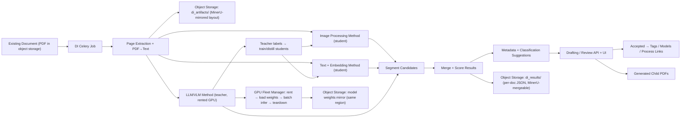

# Independent Document Intelligence Project Plan

## Summary
Build a separate **Document Intelligence (DI)** module that runs as a new Celery workflow and can be used by the existing Porsa backend **without changing** the old document ingestion/search behavior.

The module analyzes already-uploaded PDFs, detects whether one PDF contains multiple logical documents or sections, classifies each page range, extracts metadata, suggests tags/models/process links, and optionally generates new child PDF documents from the detected page ranges.

Because the source documents are **private**, the high-quality method runs on **self-hosted VLM/LLM servers** (rented GPU by the hour/day), not a public API. The plan therefore has two intertwined tracks:

1. **Application track** — the DI module, data model, methods, review/drafting flow, and split output.
2. **Infrastructure track** — an automated, cost-optimized way to spin up rented GPU nodes, load private VLM/LLM weights *fast*, run inference in **batches**, save results to **object storage** (mirroring the MinerU layout), and tear the nodes down.

Default decisions:
- Input: PDF only.
- Processing unit: page ranges.
- Output split files: child documents linked to the original parent document.
- Unknown models: create *suggestions* first; users approve in a **drafting/review screen** before any real `ManagedModel` creation or tag link.
- VLM serving: **OpenAI-compatible endpoint** (vLLM / llama.cpp style) so `llm_vlm_method.py` does not care whether the backend is local or rented.
- GPU hosting: **on-demand rented nodes, exclusive whole-day (non-interruptible)**. You rent a GPU/box for, e.g., one day; nobody can preempt your session, but you **pay for the whole day even when idle**. So the cost unit is the **node-day**, and the optimization is to **drain as much backlog as possible inside each rented day**. No spot/interruptible runs.
- **The VLM weights are very large and must be loaded across 3 GPUs** (tensor/model parallel, e.g. vLLM `--tensor-parallel-size 3`), as **one VLM instance** per node — not many small instances. Models are **quantized to 8-bit or 16-bit** to fit.
- **MinerU (PDF→text/images) also needs a GPU** and **runs first**, before the VLM stage. It is a separate GPU job from the VLM node.
- Teardown is **manual** — the code cannot stop a rented server. The Fleet Manager only *reports* progress/cost and signals "safe to shut down now"; **you terminate the node yourself**.
- Model weights: **pre-baked into the node image** *and* mirrored in **object storage in the same region** as the GPU nodes, plus a warm local NVMe cache → near-zero download on boot.
- Old pipeline: untouched except for optional integration points.

## How to read this plan
The work is organized into **phases**. **Each phase is delivered by a small set of self-contained prompts** (in the same style as the master-plan §8 prompts: project context + the modular-monolith rules + one task spec). You hand the prompts to an assistant one at a time, in order. Every prompt lists its **deliverables** and **acceptance checks** so it can be verified before moving on.

> Repo rules still apply to every prompt (`AGENTS.md`): Alembic owns the schema, register models in `backend/Models/__init__.py`, no cross-module model imports, every route permission-protected and seeded, heavy work → Celery (`202 + task_id`), catalogued errors only, money fields use 4 columns, tests required, backward compatibility mandatory.

## Architecture


## Main Capabilities
- Detect document boundaries inside a mixed PDF.
- Run **PDF→text** on every file (reuse MinerU output when present; otherwise pdfminer/OCR fallback) and store it.
- Classify each page range by: tag, managed model/instrument, process/part/category, or unknown-model candidate.
- Extract metadata: title, summary, detected language, page range, key terms, model/manufacturer candidates, confidence score, evidence text.
- Generate child PDFs from accepted page ranges.
- Link child documents and/or parent page ranges to existing tags and models.
- Suggest new models when the detected model does not exist.
- **Draft → review → accept**: a human sees the extracted data from each document, accepts/edits it, and on accept the data is applied automatically to tags and models.
- Run the expensive teacher (VLM) on **rented GPU in batches**, then **distill** cheaper student methods so most future documents never touch a GPU.

## Object Storage Layout (mirror MinerU so results merge into the main data)
All DI artifacts and results live in the **same object storage** (`StorageManager`, bucket `porsa-assets`) used by the main pipeline, under a parallel prefix keyed by the document so they sit next to the MinerU output and can be folded into the main data with no special-casing.

```text
porsa-assets/
  documents/<doc_id>/
    original.pdf                     # existing
    mineru/ ...                      # existing MinerU output (_middle.json, md, images)
    di/                              # NEW — Document Intelligence, mirrors MinerU conventions
      artifacts/
        page-0001.png                # rendered page image
        page-0001.txt                # PDF→text per page (MinerU text reused if available)
        pages.jsonl                  # one line per page: text + image key + hash
      teacher/
        raw_responses/seg-xxxx.json  # raw VLM/LLM JSON per batch (audit/replay)
      results/
        segments.json                # merged segments + page ranges + confidence
        suggestions.json             # tag/model/process suggestions + evidence
        metadata.json                # title/summary/language/key terms per segment
      outputs/
        child-<segment_id>.pdf       # generated split PDFs
```

Rules: the DI prefix is **additive** — nothing under `mineru/` is touched. Result JSON uses the **same identifiers** (document id, page indices) MinerU uses, so a later "merge into main data" step is a direct join, exactly like the user's existing MinerU flow.

---

## Phase 0 — Foundation (module skeleton, schema, review status)
**Goal:** the DI module, tables, schemas, routes, and Celery task exist and store jobs/segments/suggestions/statuses. No heavy processing yet.

Data model (independent tables, old tables untouched):
- `document_intelligence_jobs` — document id, status, method config, error, timestamps.
- `document_segments` — parent document id, start page, end page, title, summary, confidence.
- `document_segment_suggestions` — segment id, suggestion type, target type, target id, proposed name, confidence, evidence, status.
- `document_split_outputs` — parent document id, segment id, child document id, generated PDF asset id.
- `model_creation_suggestions` — manufacturer, model, type, description, evidence, confidence, status.

Statuses: suggestion `pending | accepted | rejected`; job `queued | running | completed | failed | cancelled`.

API (new namespace):
```text
POST   /document-intelligence/jobs
GET    /document-intelligence/jobs/{job_id}
GET    /document-intelligence/documents/{doc_id}/segments
GET    /document-intelligence/segments/{segment_id}/suggestions
PATCH  /document-intelligence/suggestions/{suggestion_id}
POST   /document-intelligence/segments/{segment_id}/split
POST   /document-intelligence/model-suggestions/{suggestion_id}/accept
```

**Prompts**
- **P0.1 — Tables & migration.** Add the five SQLAlchemy models, register them in `backend/Models/__init__.py`, write one Alembic migration. *Acceptance:* `alembic check` clean; tables created; no change to existing tables.
- **P0.2 — Schemas & service stubs.** Pydantic schemas (canonical segment/suggestion format) + empty service functions. *Acceptance:* import-clean; unit test for schema validation.
- **P0.3 — Routes + RBAC.** Add routes under the new namespace, each `require_permission("document_intelligence:*")`, seed the permissions in `seed_rbac.py`. *Acceptance:* every route returns 403 without permission; 200/202 with it.
- **P0.4 — Celery task skeleton.** Register `document_intelligence.process_document`; it only transitions job status for now. *Acceptance:* `POST /jobs` returns `202 + task_id`; job row moves `queued → running → completed`.

---

## Phase 1 — PDF Page Pipeline + PDF→Text + Object-Storage Mirroring
**Goal:** for any existing document, produce per-page text and per-page images, run **PDF→text on the file**, and write everything to object storage in the MinerU-mirrored `di/` layout.

Workflow steps (in the Celery task):
1. Load an existing processed PDF/document and its `original.pdf` from object storage.
2. **Reuse MinerU text per page when present**; otherwise extract with pdfminer, OCR fallback (pytesseract) for scanned pages.
3. Render pages to images for visual methods.
4. Write `di/artifacts/` (page images, `page-*.txt`, `pages.jsonl`) to object storage and one `DocumentPageArtifact` row per page.

**Prompts**
- **P1.1 — Source loading.** Pull `original.pdf` (and MinerU `_middle.json`) from `StorageManager`; handle "document missing / not yet MinerU-processed" with a catalogued error. *Acceptance:* job fails cleanly on a missing/unprocessed doc.
- **P1.2 — PDF→text + OCR fallback.** Per-page text: reuse MinerU output, else pdfminer, else OCR for image-only pages. Store `page-*.txt`. *Acceptance:* text-PDF and scanned-PDF fixtures both yield non-empty per-page text.
- **P1.3 — Page rendering + artifacts.** Render page images, write `pages.jsonl` (text + image key + content hash), upload to `di/artifacts/`, create `DocumentPageArtifact` rows. *Acceptance:* page count matches; re-running is a cached no-op unless `force=True`.
- **P1.4 — Storage mirroring contract.** Centralize the `di/` key builder so all later phases write under the same MinerU-parallel prefix and identifiers. *Acceptance:* a documented helper produces keys that join 1:1 to MinerU output.

---

## Phase 2 — GPU Serving Infrastructure (rented day-nodes, fast load, batch)
**Goal:** an automated, cost-optimized way to run the two private GPU stages. There are **two GPU job types**, run in order:

1. **MinerU node (runs first)** — GPU PDF→text/images. Batches many PDFs; on failure it **shrinks the batch** and retries the bad ones.
2. **VLM node (runs second)** — one VLM instance, weights loaded across **3 GPUs** (tensor parallel), quantized 8/16-bit, behind an OpenAI-compatible endpoint.

Both are **rented exclusively by the day, non-interruptible**, and **torn down manually by you** — the code never stops a server; it only tells you when the queue is drained and it is safe to shut down. Because you pay for the whole day regardless of use, the design **maximizes work done inside one rented day** and is **resumable** so a crash or a re-rent continues from the last finished batch rather than restarting.

### 2.1 Weight storage for fast loading
- Keep the **canonical weights in object storage in the same region** as the GPU provider (a "model registry" prefix, e.g. `porsa-models/<model>/<revision>/`).
- **Pre-bake** the runtime + (where size allows) the weights into the **node image/snapshot** — llama.cpp / vLLM already installed, so a fresh node is "warm," not a cold `pip install`.
- On boot, the node **mirrors weights from the regional object store to a local NVMe cache** (fast local network, no public download). If the image already contains the weights, this is a checksum verify, not a copy.
- Result: spin-up to "ready to serve" is dominated by the 3-GPU VRAM load, not download.

### 2.2 Fleet Manager (automation, no auto-teardown)
A small service/CLI that:
1. **Picks the cheapest suitable GPU box** for the model (price differs by GPU type; the VLM box must have ≥3 GPUs of enough VRAM for the quantized weights). Ranks by `$/day ÷ throughput`.
2. **Rents the node and boots** it from the pre-baked image (MinerU image or VLM image).
3. **Health-checks** the endpoint (MinerU service, or the OpenAI-compatible VLM endpoint) and registers it.
4. **Dispatches batched work**, checkpointing progress to object storage after each batch.
5. **Does NOT terminate the node.** When the queue drains (or the rented day is ending), it surfaces a clear **"work complete — safe to shut down"** status and the recorded cost; **you stop the node manually.**
6. Records **node-days × price** as cost on the job record.

### 2.3 Resumable batch inference
- Work is submitted in **batches** (pages/segments grouped per call, `DI_LLM_MAX_PAGES_PER_CALL`), not one request per page — keeps the GPUs saturated and minimizes node-days.
- A document-level queue lets the rented node drain **the whole backlog** in one day.
- After each batch, a **checkpoint** (which doc/page/segment is done) is written to object storage, so if the node dies or you re-rent the next day, processing **resumes from the last finished batch**.
- **MinerU adaptive batching:** PDFs are processed in batches; if a batch errors (e.g. a malformed/huge PDF), the batch size is **automatically halved and retried**, isolating the bad file instead of failing the whole run.

**Prompts**
- **P2.1 — Model registry + sync.** Define the `porsa-models/` object-storage layout and a boot-time `sync_weights` step (object store → local NVMe, checksum-verified). *Acceptance:* a node with no weights becomes serve-ready by pulling only from the regional store.
- **P2.2 — Pre-baked node images (MinerU + VLM).** Two reproducible image builds: (a) MinerU GPU image; (b) VLM image with vLLM/llama.cpp serving the quantized model across **3 GPUs** (`--tensor-parallel-size 3`) on an OpenAI-compatible endpoint. *Acceptance:* MinerU image converts a sample PDF on GPU; VLM image exposes a healthy endpoint with the model sharded over 3 GPUs.
- **P2.3 — Fleet Manager (rent/boot/report, manual teardown).** Pick cheapest box, boot, health-check, report progress + cost, and emit a "safe to shut down" signal. **No terminate call.** Pluggable GPU-provider driver (rent/boot/list-price; terminate is a no-op/manual). *Acceptance:* dry-run estimates `$/day`; a real run boots, serves a probe, reports completion; you confirm the node is stopped by hand.
- **P2.4 — Resumable batch dispatcher.** Group work into batches, checkpoint after each batch to object storage, resume from the last checkpoint on restart. *Acceptance:* killing the run mid-backlog and restarting continues from the last finished batch, not from zero.
- **P2.5 — MinerU adaptive batching.** Batch PDFs through the MinerU GPU; on batch failure, halve and retry to isolate the offending file. *Acceptance:* a batch containing one bad PDF still processes all the good ones; the bad file is quarantined with a logged error.
- **P2.6 — Endpoint wiring.** Point `llm_vlm_method.py` (`openai_base_url`) at the VLM node via config; **no app code change** when switching local ↔ rented. *Acceptance:* the same method runs against a local model and the rented node by config alone.

> Note on reusing the existing Celery task: the current MinerU pipeline saves **embedded figure images** (under `images/`, via `image_path`) but **not full-page renders**. The VLM stage needs full-page images, which Phase 1's `pdf2image` step provides — so the existing task can be reused for text, with full-page rendering added alongside.

---

## Phase 3 — Teacher Method (VLM/LLM) at Scale
**Goal:** run the highest-quality method over the batches, produce structured segments + suggestions, and **save raw + parsed results to object storage** for later reuse.

**Ordering:** MinerU runs **first** (Phase 1/2 GPU job) to produce text + full-page images for the whole backlog; **then** the VLM node processes those artifacts. The VLM stage is resumable (Phase 2 checkpoints), so it can be continued across rented days.

Techniques (already scaffolded in `llm_vlm_method.py`): page inventory → boundary detection → segment construction → classification + metadata → validation, all JSON-mode with Pydantic validation; VLM over page images for scanned/layout-heavy pages.

**Prompts**
- **P3.1 — Teacher run over batches.** Drive the five-step pipeline through the Phase-2 resumable dispatcher (after MinerU has produced artifacts); persist raw JSON to `di/teacher/raw_responses/` (audit/replay) and normalized output to the canonical format. *Acceptance:* valid structured output or a controlled failure; raw responses recoverable; a re-run resumes from the last checkpoint.
- **P3.2 — Results to object storage.** Write `di/results/segments.json`, `suggestions.json`, `metadata.json` with MinerU-compatible identifiers. *Acceptance:* result JSON joins 1:1 to the page artifacts and MinerU output.
- **P3.3 — Teacher label export.** Emit a clean labeled dataset (page-range labels, tag/model targets, evidence) for Phase 4 distillation. *Acceptance:* dataset re-loadable; one row per labeled segment.

---

## Phase 4 — Cheaper Student Methods + Distillation
**Goal:** "teach other methods for the same result." Use the teacher's saved labels to build/train cheaper methods that reproduce the teacher's output without a GPU for most future documents.

### Method A — Image Processing (student)
Page visual similarity, layout/header/footer changes, logo/table/image pattern changes, image-hash/feature-vector comparison, optional visual-embedding page similarity. Goal: detect boundaries without text.

### Method B — Text + Embeddings (student)
Embed each page/chunk, compare adjacent pages for semantic shift, compare ranges against tag/model descriptions, detect model names/manufacturers, cluster pages into sections. Goal: low-cost production classification/segmentation.

### Distillation
Train/tune A and B against the **teacher labels** from P3.3; measure how closely each reproduces the teacher; set confidence thresholds where a student's answer is trusted and the teacher (GPU) is skipped.

**Prompts**
- **P4.1 — Image method.** Implement visual boundary detection → segment candidates in canonical format. *Acceptance:* returns boundary candidates on the eval set.
- **P4.2 — Embedding method.** Page embeddings, semantic-shift boundaries, tag/model matching → segment + metadata suggestions. *Acceptance:* classifies against existing tags/models.
- **P4.3 — Distillation + thresholds.** Fit/tune students to teacher labels; produce a per-method agreement report and a confidence threshold for "skip the teacher." *Acceptance:* documented threshold above which students run GPU-free; agreement metrics stored.

---

## Phase 5 — Result Merging + Scoring
**Goal:** combine the three methods into one set of non-overlapping segments with calibrated confidence, preferring human review before any change is applied.

**Prompts**
- **P5.1 — Normalize + merge.** Reconcile overlapping predictions into valid non-overlapping page ranges; record which methods agreed. *Acceptance:* segments are valid and non-overlapping after merge.
- **P5.2 — Confidence scoring.** Blend method agreement + per-method confidence into one score per segment/suggestion. *Acceptance:* higher agreement ⇒ higher score; thresholds drive the review queue ordering.

---

## Phase 6 — Drafting / Review / Accept → Merge into Main Data
**Goal:** the drafting scenario, end to end. The flow per document is: **MinerU PDF→text/images → VLM produces structured output → reviewer sees the extracted data → on accept it is written into your real tables and search data.** A reviewer sees the **extracted data per document** (segments, metadata, suggested tags/models/process links, evidence, confidence), can edit/accept/reject, and on **accept** the data is applied **automatically** to tags and models — and optionally split into child PDFs.

Acceptance behavior:
- Accept tag suggestion → create/update tag-document/page-range link.
- Accept model suggestion → link the segment/child document to an existing `ManagedModel`.
- Accept unknown-model suggestion → create `ManagedModel`, then link it.
- Split segment → generate a child PDF + child document record linked back to the parent.

**Versioning / re-runs:** when a document is re-processed later (better model), new output does **not** silently overwrite. The system **flags the differences and suggests the change to the reviewer** (old value → proposed new value); the reviewer accepts or keeps the current one. Superseded drafts are marked, not deleted.

**Prompts**
- **P6.1 — Review/draft read API + payload.** `GET segments`/`GET suggestions` returns everything the drafting screen needs (text, image keys, evidence, confidence, proposed targets). *Acceptance:* a reviewer can render a full draft from one document's results.
- **P6.2 — Accept/reject + auto-apply (merge into main data).** `PATCH suggestion` applies tag links / model links / model creation on accept, **writing into the real CMMS tables and search index**, inside the caller's RBAC, via draft-and-confirm. *Acceptance:* accepting a tag creates the expected link in the main data; unknown-model is **not** created until accepted; accepted model creates/links `ManagedModel`; the accepted record is queryable through the normal app, identical to MinerU-sourced data.
- **P6.3 — Segment split → child PDF.** `POST split` generates the child PDF to `di/outputs/`, creates the child document linked to the parent, records `document_split_outputs`. *Acceptance:* child PDF + child document exist and stay linked to the parent.
- **P6.4 — Re-run versioning + change suggestions.** On re-processing, diff new vs. existing suggestions/links; present a "suggested change" (old → new) per field; reviewer accepts or rejects; superseded drafts marked with a `revision`. *Acceptance:* a second run on the same document shows change suggestions instead of duplicates or silent overwrites.
- **P6.5 — (Optional) Review UI.** Drafting screen listing documents, per-segment cards, accept/edit/reject, change-suggestion view, bulk-accept above a confidence threshold. *Acceptance:* end-to-end accept from the UI applies links and merges into main data.

---

## Phase 7 — Human-Correction Feedback Loop
**Goal:** close the loop. The reviewer's edits and accept/reject decisions in Phase 6 are **gold labels**. Feed them back into Phase 4 so the cheaper student methods keep improving and more documents clear without ever touching the GPU teacher.

**Prompts**
- **P7.1 — Capture corrections as labels.** Persist every reviewer edit/accept/reject (final page range, final tag/model, "teacher was wrong here") as a labeled record next to the teacher labels. *Acceptance:* each review action produces a re-loadable gold label tied to its segment.
- **P7.2 — Periodic re-distillation.** Re-train/tune the image + embedding students on (teacher labels + human corrections); report whether agreement with humans improved; raise the "skip the teacher" confidence threshold as students improve. *Acceptance:* a re-distillation run shows measured change in human-agreement and updates the threshold.

---

## Phase 8 — Evaluation + Report
**Goal:** compare the three methods on one labeled dataset and document the cost/quality tradeoff (this doubles as the academic deliverable).

Research questions: which method best detects boundaries in mixed technical PDFs; which best classifies page ranges into tags/models/process parts; the accuracy ↔ latency ↔ cost tradeoff; whether lightweight students match the teacher well enough to run GPU-free.

Evaluation dataset: labeled mixed PDFs (simple, scanned, multi-instrument, unknown-model) with true page ranges, tags, models, and process parts.

Metrics: boundary precision/recall/F1; classification accuracy; unknown-model detection; metadata quality; processing time per page; **cost per document** (incl. rented node-hours); human correction rate.

**Prompts**
- **P8.1 — Eval harness.** Run all three methods on the dataset; compute the metrics; output a comparison table incl. cost/doc. *Acceptance:* reproducible report from one command.
- **P8.2 — Final report + docs.** Write the academic report and implementation docs (architecture, infra runbook, distillation results). *Acceptance:* a reader can reproduce the pipeline and the cost numbers.

---

## Phase 9 — Security & Compliance (OPTIONAL — decide later)
**Goal:** keep this as a **self-contained, optional phase you can turn on or skip** later. Because the VLM/MinerU run on rented third-party hardware and the documents are private petroleum data, this phase hardens the data path. Nothing in Phases 0–8 depends on it, so you can defer it.

Scope (pick any subset when you decide):
- **Encryption in transit** — TLS/VPN between the app and the rented node; private network so the endpoint is never public.
- **Encryption at rest** — encrypt weights and document artifacts in object storage and on the node's local NVMe.
- **NVMe wipe on teardown** — before you stop the rented box, wipe the local cache (weights + documents) so nothing is left on third-party disk.
- **Provider terms** — only rent from providers whose terms permit storing your private data; record the choice.
- **Access scoping** — short-lived credentials for the node to read weights/artifacts, revoked at end of the rented day.

**Prompts**
- **P9.1 — Private network + TLS.** Put the VLM/MinerU endpoints behind a private network/VPN with TLS; the app reaches them over that, never the public internet. *Acceptance:* the endpoint is unreachable publicly; the app still works.
- **P9.2 — At-rest encryption + scoped credentials.** Encrypt weights/artifacts at rest; give the node short-lived, least-privilege credentials. *Acceptance:* a leaked node credential cannot read beyond its scope and expires.
- **P9.3 — Teardown wipe checklist.** A documented (and where possible scripted) wipe of NVMe before manual shutdown, plus a provider-terms note. *Acceptance:* a runbook step the operator follows before stopping each node.

---

## Test Plan
- Job creation does not modify old document processing.
- Job fails cleanly if the source document is missing or not processed.
- PDF→text yields per-page text for both text and scanned PDFs.
- Artifacts/results are written under the MinerU-mirrored `di/` prefix with joinable identifiers.
- MinerU runs first and saves text + full-page images; a batch with one bad PDF still processes the good ones (adaptive batch shrink).
- VLM image serves the quantized model across 3 GPUs on an OpenAI-compatible endpoint.
- Fleet Manager: dry-run estimates `$/day`; real run boots → serves → reports "safe to shut down" (no auto-terminate); cost recorded as node-days.
- Resumable dispatcher: killing a run mid-backlog and restarting continues from the last finished batch, not from zero.
- Batch dispatcher drains a multi-document queue without per-page calls.
- Page-range segments are valid and non-overlapping after merge.
- Image method returns boundary candidates; embedding method classifies against existing tags/models; teacher returns valid structured output or a controlled failure.
- Distilled students meet the documented agreement threshold for GPU-free runs; human corrections re-distill and move the agreement metric.
- Unknown model suggestion does not create a model until accepted; accepted model creates/links `ManagedModel`; accepted tag creates the expected link; accepted records are queryable through the normal app (merged into main data).
- Re-running a document yields change suggestions (old → new), not duplicates or silent overwrites.
- Split segment creates a child PDF + child document that stays linked to the parent.
- All APIs enforce company/user access rules.

## Assumptions
- A separate module inside the same backend, not a rewrite. Old upload, MinerU ingestion, chunking, and search endpoints stay compatible.
- The new system operates after a document already exists.
- Human review (drafting screen) is required before creating models or applying classification links.
- Child documents are the preferred output for separated PDF parts.
- GPU is **rented on demand**, priced per GPU type; nodes are ephemeral and may be interrupted.
- Weights are private and never leave the user's object storage / rented region.

---

## Resolved in this revision
Folded into the phases above, per your decisions:

- **Security/encryption** → **Phase 9 (optional, decide later)**; VLM weights loaded across **3 GPUs** baked into the default decisions and Phase 2.
- **Non-interruptible whole-day exclusive rental, pay-for-idle, manual teardown** → Phase 2 (Fleet Manager reports "safe to shut down"; you stop the node).
- **Resume from last batch** → Phase 2 resumable dispatcher with object-storage checkpoints.
- **Quantization 8/16-bit** and **MinerU is also a GPU stage that runs first, with adaptive batch shrink on failure** → Phase 2.
- **Merge into main data on user acceptance** → Phase 6 (P6.2).
- **Re-run versioning = suggest changes to users** → Phase 6 (P6.4).
- **Human-correction feedback loop** → new **Phase 7**.
- **Throughput model** = one VLM instance (3 GPUs) node + one MinerU GPU node, MinerU first → Phase 2/3.

## Still open — let's talk after these changes
1. **PII / petroleum-data compliance.** Confirm whether any document content is export- or contract-restricted before it can sit on rented hardware. (Left for discussion, as you asked.)
2. **Reusing the existing Celery task for MinerU.** It saves embedded figure images but not full-page renders — decide whether to extend that task or run MinerU as a dedicated GPU job. (Noted in Phase 2.)
